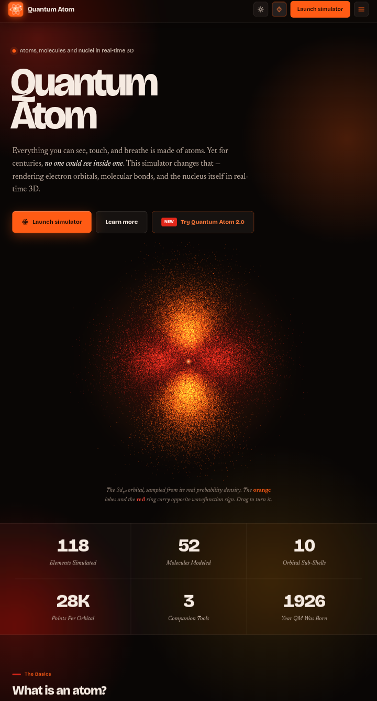
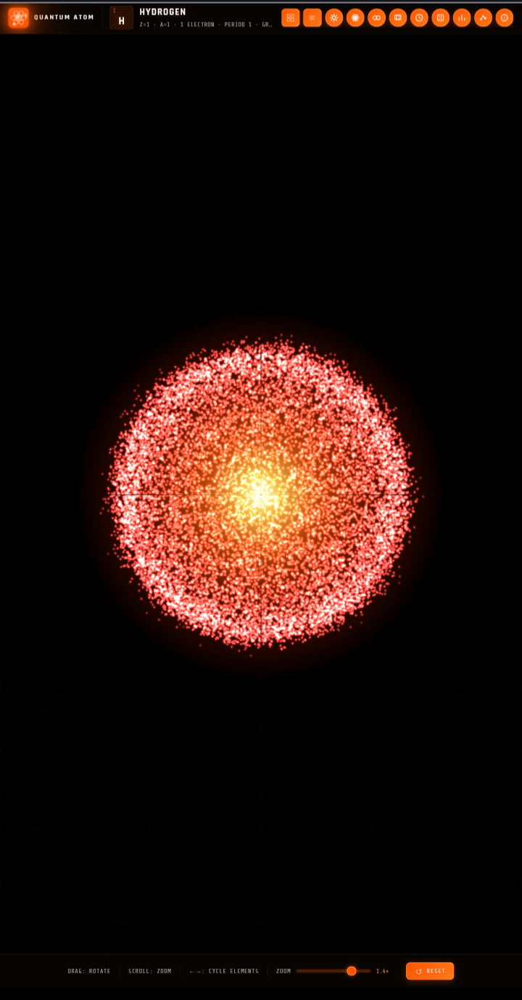
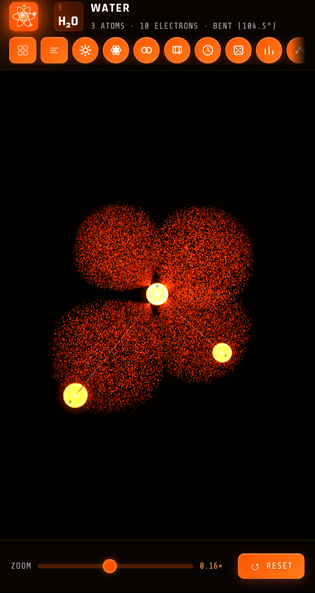
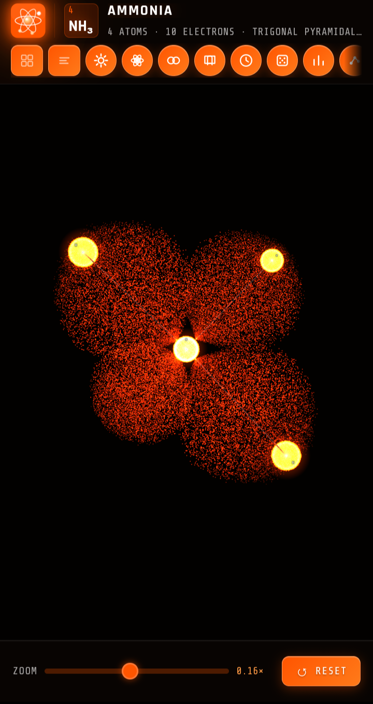
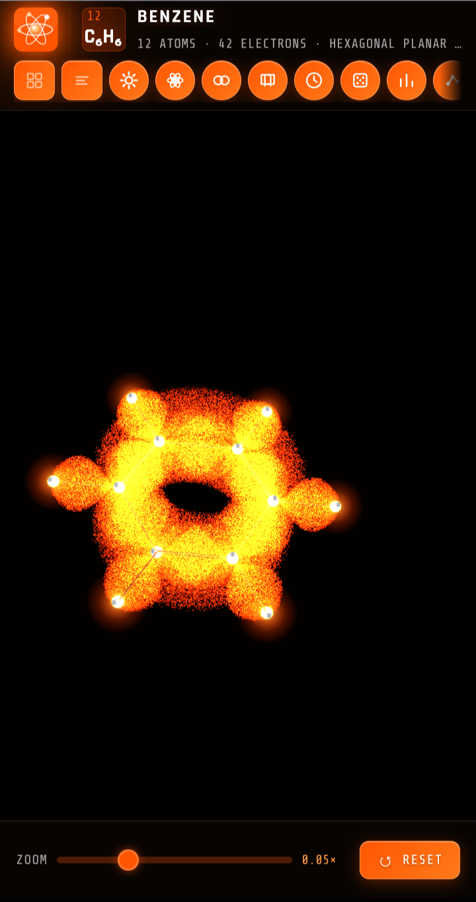
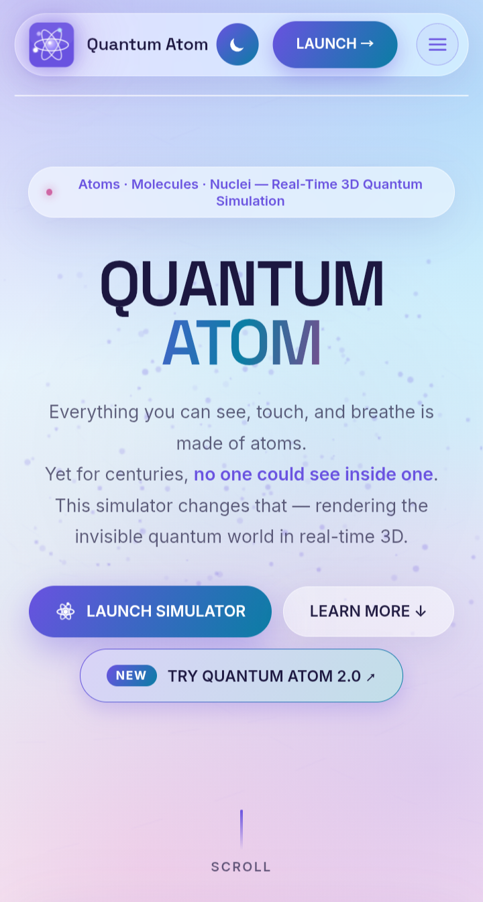
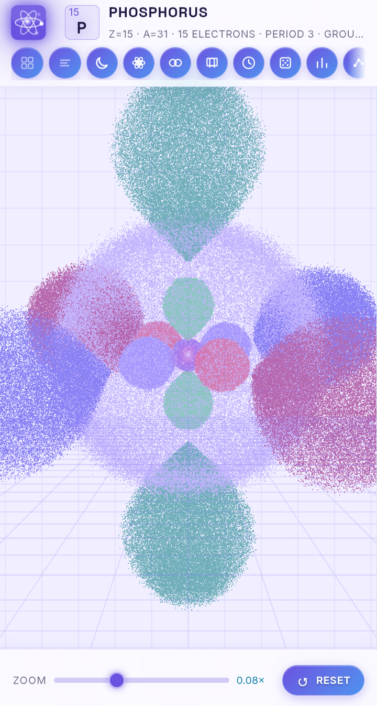

<div align="center">

# ⚛️ Quantum Atom

### Everything you were taught about the atom was a drawing.<br>This is the real thing.

**All 118 elements in one browser tab, free.**<br>See real orbitals, real molecules and real nuclei in 3D, with no install and no account.

[**▶ Launch the Simulator**](https://nazat02.github.io/Quantum-Atom/) &nbsp;·&nbsp; [The Story](#-the-story) &nbsp;·&nbsp; [Features](#-what-you-can-do) &nbsp;·&nbsp; [Run It](#-run-it-in-30-seconds) &nbsp;·&nbsp; [**Support the Project**](#-support-the-project)

<br>



<table>
<tr>
<td></td>
<td></td>
<td></td>
</tr>
<tr>
<td></td>
<td></td>
<td></td>
</tr>
</table>

</div>

---

## 💔 The problem

Remember the atom from school? A dot in the middle. A few smaller dots circling it like tiny planets.

**It's wrong.** Your teacher knew it. The textbook knew it. It stayed on the page because the truth is hard to draw, and nobody gave you a better picture.

So a whole generation grew up believing:

- electrons *orbit* the nucleus (they don't),
- atoms are *mostly solid stuff* (they're almost entirely empty),
- chemistry is *memorization* (it's geometry you were never shown).

Students can recite "2, 8, 8, 18" but can't say **why water is bent**, why **helium never reacts**, or why **neon signs glow orange**. The tools that *do* show the truth are heavy, licence-gated desktop software built for people who already understand it.

> **There was nothing in between: something you could open in a browser, in ten seconds, and just *get it*.**

---

## ✨ The idea

Open a link. Pick any element. Watch its electrons appear, not as dots on rails, but as glowing clouds of probability shaped by the mathematics of quantum mechanics. Spheres. Dumbbells. Cloverleaves. Rings.

Then keep going:

- Snap two atoms together and watch a **molecule** form.
- Type the name of *anything* and **build it**.
- Dive into the **nucleus**, past the protons and neutrons, down to the **quarks**.
- Flip a switch and see the **antimatter** version of the same thing.

No install. No account. No equations required. Drag to rotate, scroll to zoom.

---

## 🌍 Why it matters

| Chemistry has always said… | Quantum Atom lets you **see**… |
|---|---|
| "Electrons fill shells in a set order." | The shells filling, element by element, from H to Og. |
| "Noble gases are stable." | A full outer shell, glowing and complete. |
| "Water is bent." | The geometry that forces the bend, with angles from VSEPR theory. |
| "Orbitals are s, p and d." | The spheres, dumbbells and cloverleaves themselves. |
| "The nucleus is protons and neutrons." | Them, packed together, and the quarks inside them. |
| "Matter has an antimatter twin." | That twin, side by side with the original. |

### How it compares

| | Textbook diagram | Desktop research software | **Quantum Atom** |
|---|:---:|:---:|:---:|
| Shows real orbital shapes | ❌ | ✅ | ✅ |
| All 118 elements | ✅ (as a table) | varies | ✅ (in 3D) |
| Runs in a browser, no install | ✅ | ❌ | ✅ |
| Free | ✅ | usually ❌ | ✅ |
| Made for beginners | ✅ | ❌ | ✅ |
| Interactive, rotate and zoom | ❌ | ✅ | ✅ |
| Atoms, molecules *and* nuclei in one place | ❌ | ❌ | ✅ |

---

## 📖 The story

Quantum Atom is a journey in four chapters.

| | Chapter | The question it answers |
|---|---|---|
| **1** | **The Atom** | *"What does an electron actually look like?"* |
| **2** | **The Molecule** | *"Why do atoms stick together, and why are the shapes what they are?"* |
| **3** | **The Nucleus** | *"What's inside the middle?"* |
| **4** | **The Mirror** | *"What if everything were made of antimatter?"* |

The landing page walks through history: **Democritus** guessing in 400 BCE, **Dalton's** billiard balls, **Thomson's** plum pudding, **Rutherford's** gold-foil shock, **Bohr's** planetary orbits, and finally **Schrödinger, Heisenberg and Born**, who threw out the orbits altogether.

---

## 🎯 What you can do

### Understand it
- 🎓 **Guided Lessons.** *Understanding Covalent Bonds*, *VSEPR: Why Molecules Have Shapes*, and *Building Up the Periodic Table*. Each step moves the scene for you and explains it in a sentence or two.
- 🆚 **Compare Elements.** Two elements side by side.
- 🔬 **Molecule Analysis.** Dig into the structure of the molecule on screen.
- 📜 **Bohr vs. Quantum.** The model everyone learns next to the one that's actually true.

### Explore it
- 🧪 **All 118 elements**, hydrogen to oganesson, with live search and arrow-key cycling.
- 🧬 **52 molecules**, plus **Build mode** for anything else (online lookup via PubChem).
- ⚡ **Excited State.** Promote electrons to higher orbitals and watch the transition.
- 🎲 **Surprise Me** and 🕘 **Recently Viewed.**

### Make it yours
- 🌗 Light and dark themes
- 🎨 Colorblind-safe palette
- 🔮 Real Image · Ultra · Smooth · Spherical · Cartesian Grid
- 🪞 Antimatter mode, for atoms *and* molecules

### Go all the way down
- 🔭 **Nucleus Explorer.** Continuous zoom from nucleus to quarks, with toggleable **pion exchange** and **gluon field** overlays, a color legend, and element-by-element navigation.

---

## 🧭 A quick tour: your first five minutes

1. **Pick hydrogen.** One electron, one perfect sphere.
2. **Press → to step through the table.** Helium completes the first shell, lithium starts a new one. That's *why the periodic table has rows*.
3. **Jump to carbon or oxygen.** The dumbbell-shaped **p orbitals** appear.
4. **Try iron.** The cloverleaf-shaped **d orbitals** show up.
5. **Open Molecules, then water.** See the bend, then run the **VSEPR lesson**.
6. **Finish in the Nucleus Explorer.** Keep scrolling until you hit quarks.

## 🔤 The three shapes, in plain words

| Orbital | Shape | What it means |
|---|---|---|
| **s** | A sphere | The simplest cloud, the same in every direction. |
| **p** | A dumbbell (three, at right angles) | Where much of chemistry happens: carbon, nitrogen, oxygen bonding. |
| **d** | A cloverleaf (five) | Why transition metals have colour, magnetism and catalytic power. |

## ❓ FAQ

**Is it really free?** Yes. Open the link and use it.

**Do I need to install anything?** No. Any modern browser works.

**Does it work on a phone?** Yes, with touch rotate and pinch-to-zoom.

**Are the shapes real or artistic?** They are drawn from quantum probability distributions, so they are the shapes the theory predicts, not decoration.

**Can I use it in a class?** For learning, yes, by opening the official link. For hosting elsewhere or commercial use, see [License & Credit](#-license--credit).

**Why do orbitals look like fuzzy clouds?** An electron has no exact position. The cloud shows *where it's likely to be*.

---

## 👥 Who it's for

| If you are… | Quantum Atom gives you… |
|---|---|
| **A student** | The picture your textbook never had. |
| **A teacher** | A projector-ready demo from a link, with built-in lessons. |
| **A curious person** | Ten minutes of *"wait, really?"* |
| **A developer or designer** | A readable, single-file WebGL project to learn from. |

---

## 🚀 Run it in 30 seconds

**Easiest:** open the [live demo](https://nazat02.github.io/Quantum-Atom/).

**Locally:** every tool is a single self-contained HTML file. No build step, no bundler, no install.

```bash
git clone https://github.com/nazat02/Quantum-Atom.git
cd Quantum-Atom
open index_dark.html      # or index_light.html
```

> 💡 *three.js and fonts load from a CDN, and Build mode's lookups need a connection, so the first run should be online.*

---

## 🎮 Controls

### Atom & Molecule Simulator

| Action | Input |
|---|---|
| Rotate | Mouse drag · Touch drag |
| Zoom | Scroll · Pinch · Zoom slider |
| Cycle elements | ← / → arrow keys |
| Pick an element or molecule | **EXPLORE** panel (Atoms · Molecules · Build) |
| Search | Search bar in the element panel |
| Atomic data | **DATA** panel |
| Reset view | **RESET** |
| Toggle modes | **ANTIMATTER · REAL IMAGE · CARTESIAN GRID · SMOOTH ORBITALS · ULTRA MODE · SPHERICAL MODE · EXCITED STATE** |
| Lessons · Compare · Recents · Surprise · Analysis · Colorblind | Toolbar icons (top right) |
| Open Nucleus Explorer | Nucleus icon in the toolbar |

### Nucleus Explorer

| Action | Input |
|---|---|
| Zoom nucleus → quarks | Slider · Scroll · Pinch |
| Previous / next element | **‹ ›** |
| Jump to any element | **ELEMENTS** |
| Pion exchange / gluon field | **PIONS** / **GLUONS** |
| Reset camera | **RESET** |
| Legend · Help | Legend button · **?** |

**Pro tips**
- Double-click the atom to snap back into auto-spin.
- **Real Image + Smooth Orbitals** is the most cinematic combination. **Ultra Mode** is the cleanest.
- In the Nucleus Explorer, *just keep scrolling.* The physics changes as you go.

---

## 🧱 Under the hood

- **three.js r128** for 3D rendering
- **Custom GLSL shaders** for point-cloud orbitals (additive blending, per-point sizing) and Fresnel-shaded meshes in Ultra Mode
- **Vanilla JavaScript**, one self-contained HTML file per tool
- **PubChem** REST API for Build mode
- **Zero build step**

```
Quantum-Atom/
├── index.html                  # theme-aware redirect to the landing page
├── index_dark.html             # landing page: story, history, Bohr vs Quantum
├── index_light.html
├── simulator_dark.html         # atoms · molecules · build · lessons · compare · analysis
├── simulator_light.html
├── nucleus_explorer.html       # nucleus → nucleons → quarks
├── nucleus_explorer_light.html
└── images/
```

---

## 🗺️ Roadmap

- Probability-density isosurfaces
- Ionization states and electron transitions
- Electron spin visualization
- High-resolution screenshot export
- Performance and quality presets
- WebXR augmented reality: *put an orbital on your desk*

---

## 💛 Support the Project

Quantum Atom is built by one person and is **free for everyone, with no ads and no account.** If it helped you see something you'd only ever memorized, you can chip in to support the time and costs of keeping it free and improving it.

Donations are entirely optional, and nothing is locked behind them. The wallet is public, so anyone can verify it on the blockchain.

| | |
|---|---|
| **Asset** | USDT (Tether), ERC-20 |
| **Network** | **Ethereum Mainnet only** |
| **Address** | `0x9b799218B3F43c98DD6Eb7b32C00FD624e5a76DD` |
| **Verify** | [View on Etherscan](https://etherscan.io/address/0x9b799218B3F43c98DD6Eb7b32C00FD624e5a76DD) |

> ⚠️ **Send USDT on Ethereum Mainnet only.** Funds sent on any other network (Tron, BNB Chain, Polygon, etc.) may be unrecoverable. Always compare the address with the one shown on the official site, and consider sending a small test amount first. Transfers are irreversible.

Not able to donate? Starring the repo and sharing the link with someone who's still picturing tiny planets helps just as much.

---

## 📄 License & Credit

**© Md. Shaikhul Hadis Nazat. All rights reserved.**

Quantum Atom is made for **learning and personal use only**.

| ✅ You may | ❌ You may not |
|---|---|
| Open it, explore it, and learn from it | Host or re-publish it on any other domain or platform |
| Use it for your own personal study | Use it commercially in any way without a **written license** from the author |
| Share the official link with friends and classmates | Copy, redistribute, sell or repackage the files or the code |

Want to use it commercially, host it elsewhere, or build on it? **Ask first, and get written permission.**

**Created by Md. Shaikhul Hadis Nazat** (GitHub: [nazat02](https://github.com/nazat02)).

See the `LICENSE` file for the full terms.

---

<div align="center">

### The atom was never a drawing.

**[▶ Open Quantum Atom](https://nazat02.github.io/Quantum-Atom/)**, and see what you're made of.

*If it made you say "oh, wow," give it a ⭐ and send it to someone who's still picturing tiny planets.*

</div>
