<div align="center">

# ⚛️ Quantum Atom

### The Complete Quantum Atom Simulator: Atoms, Molecules, Reactions, Antimatter & Nuclei in One Free Browser Tab

**See real electron orbitals for all 118 elements, then keep going: bonds, reactions, antimatter, quarks.**

**Everything you were taught about the atom was a drawing. This is the real thing.**

An interactive, browser-based **quantum atom visualizer**: real **electron orbital** probability clouds, **VSEPR molecule geometry**, animated **chemical reactions**, **matter–antimatter annihilation**, and a **nucleus-to-quark zoom**. No install. No account. No ads. Free.

[**▶ Launch the Simulator**](https://nazat02.github.io/Quantum-Atom/) &nbsp;·&nbsp; [The Problem](#-the-problem-chemistry-is-taught-with-pictures-that-are-wrong) &nbsp;·&nbsp; [How It Solves It](#-how-quantum-atom-solves-it) &nbsp;·&nbsp; [Features A–Z](#-every-feature-explained-a-to-z) &nbsp;·&nbsp; [Controls](#-controls--keyboard-shortcuts) &nbsp;·&nbsp; [FAQ](#-faq) &nbsp;·&nbsp; [**Support**](#-support-the-project)

<br>

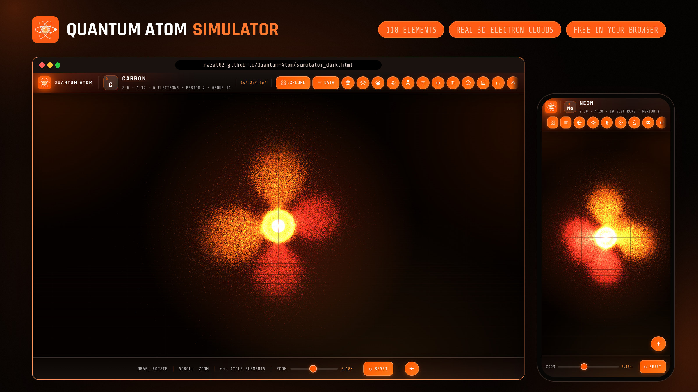

<table>
<tr>
<td>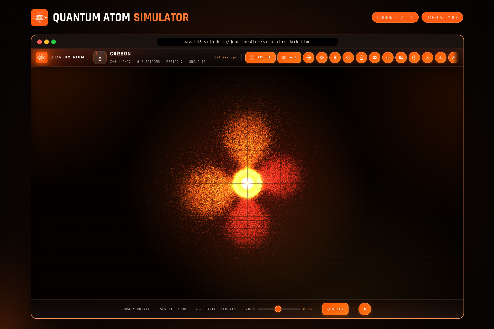</td>
<td>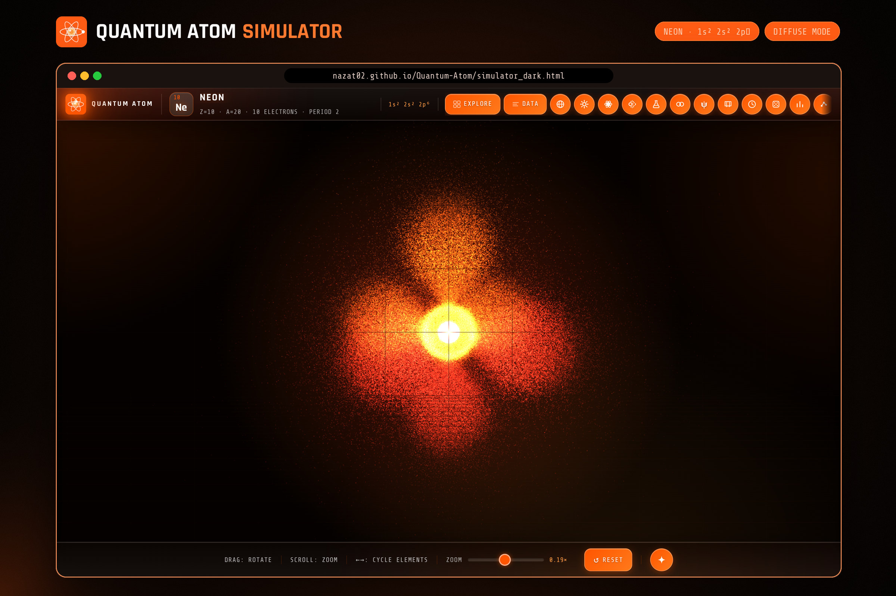</td>
</tr>
<tr>
<td>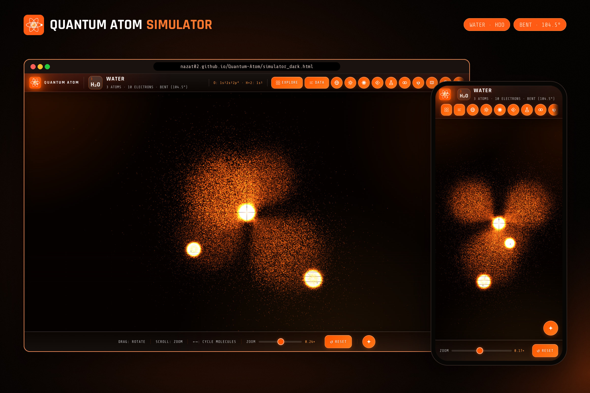</td>
<td>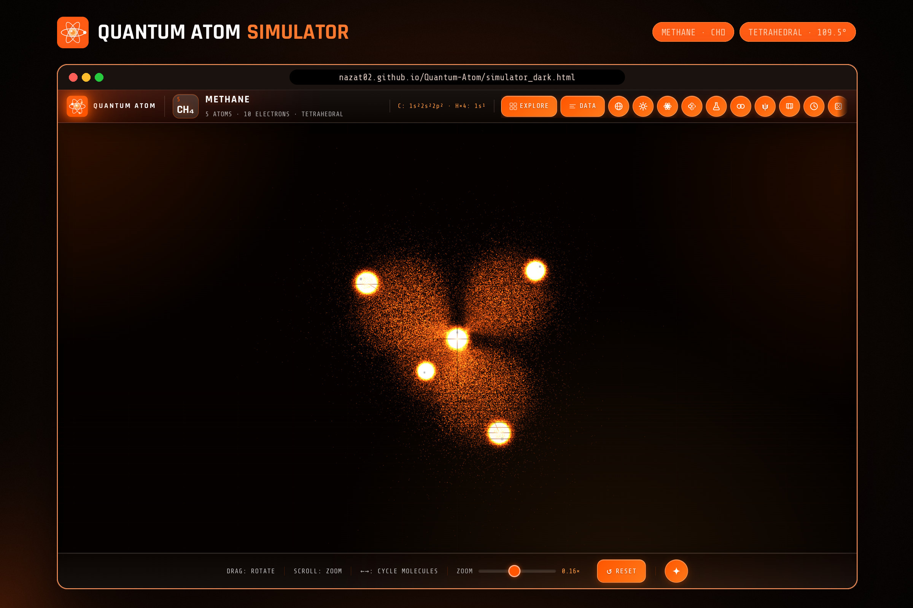</td>
</tr>
<tr>
<td>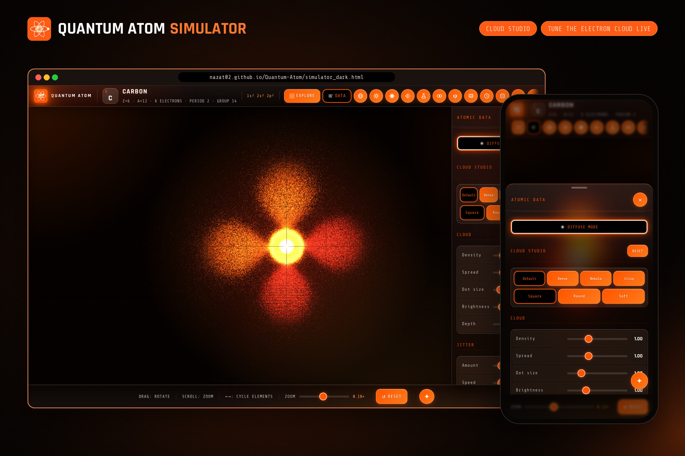</td>
<td>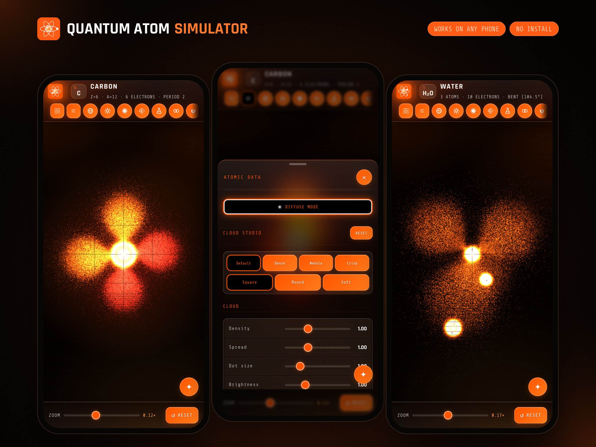</td>
</tr>
</table>

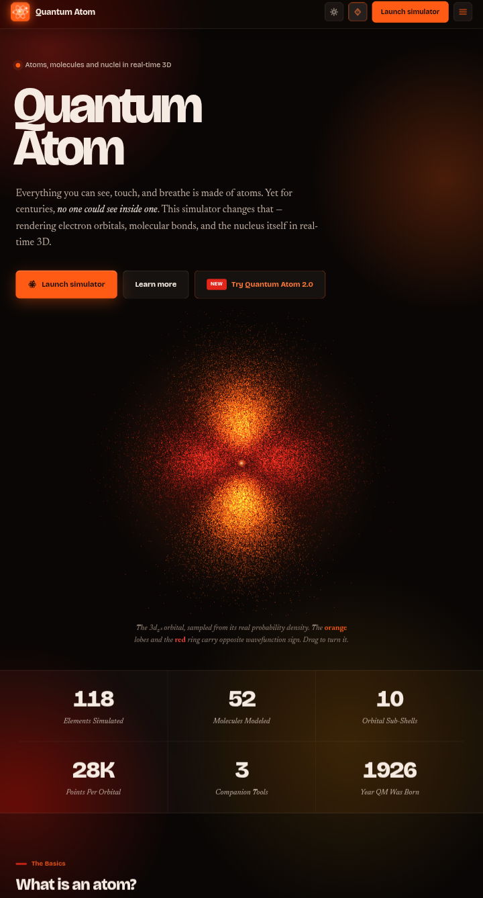

<table>
<tr>
<td>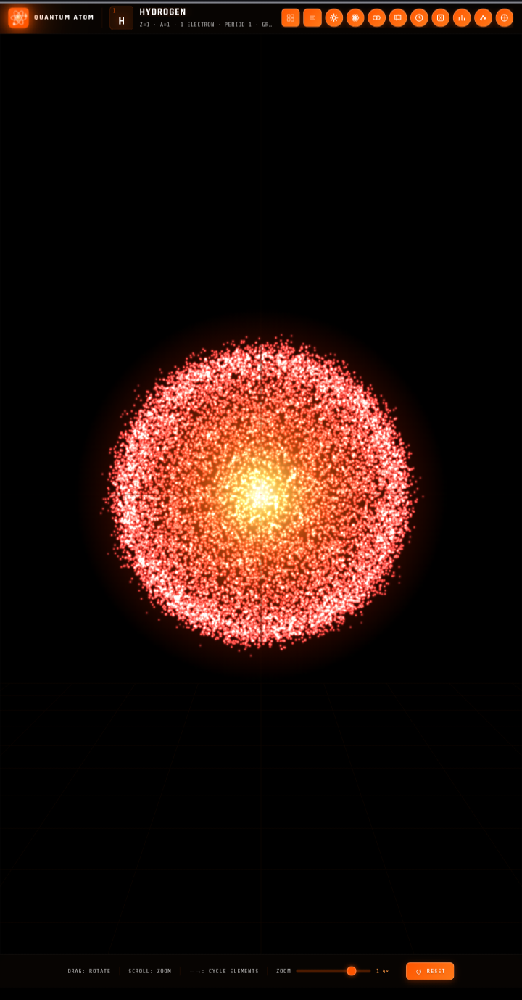</td>
<td>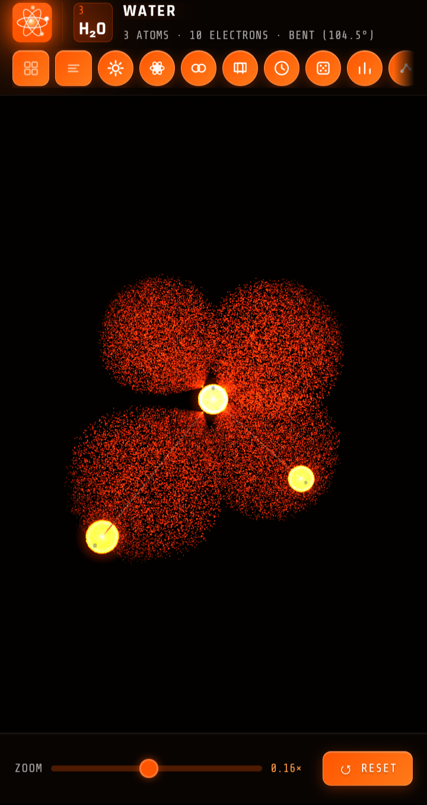</td>
<td>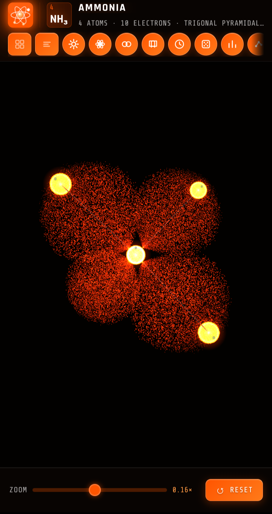</td>
</tr>
<tr>
<td>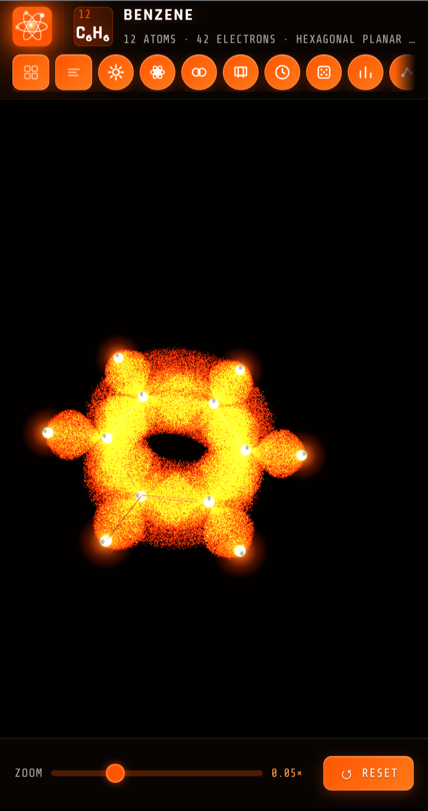</td>
<td>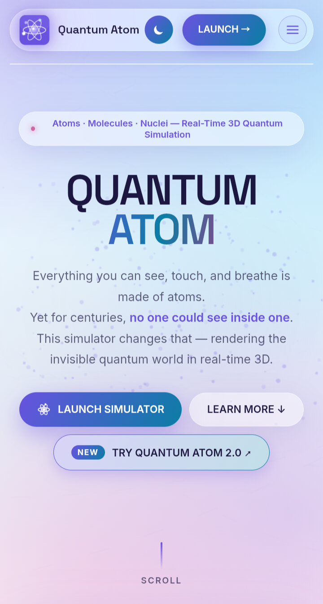</td>
<td>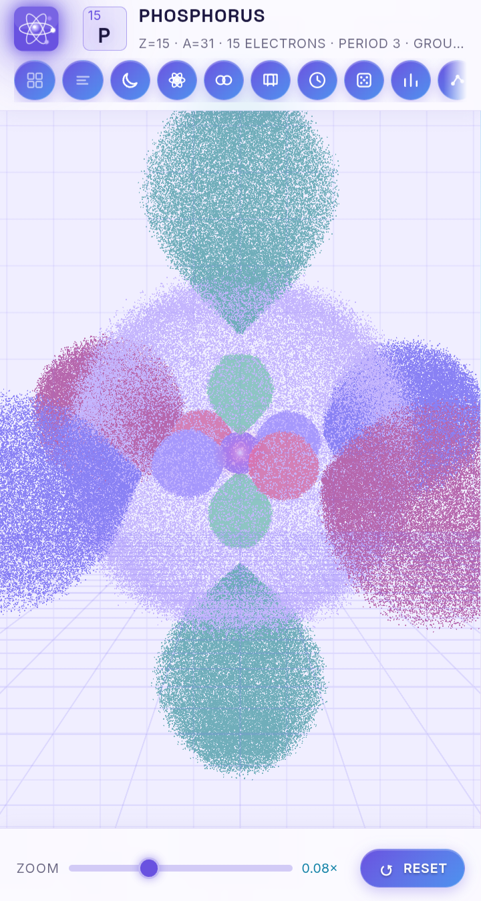</td>
</tr>
</table>

</div>

---

## 📑 Table of Contents

1. [The complete simulator](#-the-complete-quantum-atom-simulator) · [At a glance](#-at-a-glance)
2. [The problem](#-the-problem-chemistry-is-taught-with-pictures-that-are-wrong)
3. [How Quantum Atom solves it](#-how-quantum-atom-solves-it)
4. [Who it's for](#-who-its-for)
5. [The learning journey: four chapters](#-the-learning-journey-four-chapters)
6. [Every feature explained, A to Z](#-every-feature-explained-a-to-z)
7. [🤖 Physicist AI: the built-in physicist](#-physicist-ai-the-built-in-physicist) · [The three tools](#-the-three-tools)
8. [Your first five minutes](#-your-first-five-minutes)
9. [Orbital shapes in plain words](#-orbital-shapes-in-plain-words)
10. [Controls & keyboard shortcuts](#-controls--keyboard-shortcuts)
11. [Languages](#-languages)
12. [Accuracy: what is real and what is simplified](#-accuracy-what-is-real-and-what-is-simplified)
13. [How it works under the hood](#-how-it-works-under-the-hood)
14. [Run it locally](#-run-it-locally)
15. [Project structure](#-project-structure)
16. [Comparison with other tools](#-how-it-compares)
17. [Roadmap](#-roadmap)
18. [FAQ](#-faq)
19. [Support the project](#-support-the-project)
20. [License & credit](#-license--credit)

---

## 🏆 The complete Quantum Atom simulator

Most atom tools do **one** thing: an orbital viewer, a molecule viewer, a periodic table, or a reaction demo. Quantum Atom is built as **one complete, connected simulator** that carries you from a single electron to the quarks inside the nucleus, and out to a whole molecule or reaction, **without leaving the tab**.

**Everything in one place, in a single free browser app:**

| Layer | What you get |
|---|---|
| **Electron** | Real s, p, d and f orbital probability clouds for all 118 elements |
| **Atom** | Aufbau configuration, orbital box diagrams, excited states, transitions |
| **Bond** | VSEPR geometry, σ/π bonds, ionic and polar bonds, 140+ molecules, DNA |
| **Molecule** | Build anything by name via PubChem, with a full analysis report |
| **Reaction** | 280+ animated step-by-step mechanisms, plus your own equations |
| **Nucleus** | Protons, neutrons, quarks, gluon flux-tubes and pion exchange |
| **Antimatter** | Charge-conjugated atoms and molecules, and full matter–antimatter annihilation |
| **Beyond** | Hypothetical elements Z = 119–300 with Dirac supercritical physics |
| **Data** | Periodic-trend heatmaps, scatter explorer, f-block and N–Z stability charts |
| **AI** | **Physicist AI**, a grumpy, rigorous and funny physicist character that sees what's on screen, argues with pseudoscience, draws interactive 2D/3D graphs, searches the web, guards its own instructions, and works with 11 providers (including local models) |
| **Access** | 13 languages, dark/light, colorblind-safe palette, phone to projector, no install, no account, free |

> To our knowledge, no other free browser tool combines **all** of these layers in one simulator. Compare for yourself in [How it compares](#-how-it-compares).

---

## 🔎 At a glance

| | |
|---|---|
| **What it is** | A free, browser-based 3D simulator of atoms, molecules, reactions and nuclei |
| **Elements** | All **118** (hydrogen to oganesson) + **hypothetical elements Z = 119–300** |
| **Orbitals** | **s, p, d and f**, sampled from real probability densities (up to ~28,000 points per orbital) |
| **Molecules** | **140+ curated** (VSEPR-accurate) + **Build mode** for anything else, including a 588-atom **DNA double helix** |
| **Reactions** | **280+ animated reactions** in 13 categories, plus **type-your-own-equation** |
| **Nucleus** | Zoom from the whole nucleus to **protons, neutrons, quarks, gluons and pions** |
| **Antimatter** | Charge-conjugate any atom or molecule, or watch **matter meet antimatter and annihilate** |
| **Data Lab** | Periodic-trend heatmaps, scatter explorer, f-block view, N–Z stability chart |
| **Physicist AI** | A context-aware physicist character (11 providers, bring your own key or run local): interactive 2D/3D plots, full LaTeX maths, web search with sources, Markdown documents, one-tap action buttons, prompt-injection shield |
| **Languages** | **13**: English, العربية, বাংলা, Deutsch, Ελληνικά, Español, Français, हिन्दी, Italiano, 日本語, 한국어, Русский, 简体中文 |
| **Themes** | Dark and light, a colorblind-safe palette, glass/flat styling |
| **Devices** | Desktop, tablet and phone (touch rotate, pinch to zoom) |
| **Install / account / cost** | None / none / free |
| **Tech** | three.js r128 · custom GLSL shaders · vanilla JavaScript · zero build step |

---

## 💔 The problem: chemistry is taught with pictures that are wrong

Remember the atom from school? A dot in the middle. A few smaller dots circling it like tiny planets.

**It's wrong.** Your teacher knew it. The textbook knew it. It stayed on the page because the truth is hard to draw, and nobody gave you a better picture.

So a whole generation grew up believing:

- electrons *orbit* the nucleus like planets (they don't, they form probability clouds),
- atoms are *solid stuff* (they are almost entirely empty space),
- chemistry is *memorization* (it is geometry nobody showed you).

The consequences are real:

| What students struggle with | Why it happens |
|---|---|
| "Why is water **bent** but CO₂ **linear**?" | Lone pairs and electron repulsion are invisible on a flat Lewis diagram. |
| "Why do **noble gases** never react?" | A full shell is just a rule to memorize when you can't see it. |
| "What does a **d orbital** even look like?" | Flat drawings of cloverleaves and the dz² donut are almost impossible to read. |
| "What is a **π bond**?" | Sideways p-orbital overlap is meaningless without a 3D view. |
| "Why does the periodic table have **rows of 2, 8, 18, 32**?" | Shell filling is abstract until you watch it happen element by element. |
| "How does a reaction **actually happen**?" | Equations show *what* changed, not *which bonds broke, in what order*. |
| "What's **inside** the nucleus?" | Most courses stop at "protons and neutrons". |

Meanwhile, the tools that *do* show the truth are heavy, licence-gated desktop software, built for people who already understand it.

> **There was nothing in between: something you could open in a browser, in ten seconds, and just *get it*.**

---

## ✅ How Quantum Atom solves it

Quantum Atom replaces memorization with **seeing**. Every shape on screen is generated from the mathematics of quantum mechanics, not drawn by an artist.

| The old way | The Quantum Atom way |
|---|---|
| Dots on rails | **Glowing probability clouds** sampled from |ψ|², dense where the electron is likely, sparse where it isn't |
| Flat orbital diagrams | **Rotate, zoom and orbit** s, p, d and f orbitals in real 3D, with each lobe colour-coded by wavefunction sign |
| Memorized "2, 8, 8, 18" | **Step element by element** (← →) and watch shells and subshells fill |
| Lewis structures | **3D molecules** with bond angles computed from VSEPR theory, σ and π bonds drawn distinctly |
| "The reaction produces water" | **Animated step-by-step mechanisms**: which bond breaks first, where the electron pair goes, what the energy change is |
| "Antimatter exists" | **A positron-and-antiproton atom** beside the normal one, then a full **annihilation** with photons and pions |
| "The nucleus is protons and neutrons" | **A continuous zoom** past nucleons to quarks, with pion exchange and gluon flux-tubes |
| Tables of data | **Interactive charts**: trends across the periodic table, scatter plots of any two properties |
| English-only tools | **13 languages**, switchable instantly |
| Expensive software | **A link.** Free, in any browser |

### The value, in one line per audience

- **Students** get the picture the textbook never had, which turns rules into things they can *see*.
- **Teachers** get a projector-ready demo, built-in guided lessons and a visual answer to almost every "why?" question.
- **Self-learners** get a free, no-account way to build real intuition for quantum chemistry.
- **Educators and tutors** get a tool that works on school laptops, tablets and phones, in 13 languages.
- **Curious people** get ten minutes of "wait, *really*?"
- **Developers and designers** get a readable, zero-build WebGL project to learn from.

---

## 👥 Who it's for

| If you are… | Quantum Atom gives you… |
|---|---|
| **A high-school chemistry or physics student** | Orbitals, shells, bonding, VSEPR and reactions you can see, rotate and replay. |
| **A first-year university student** | Hybridization, formal charge, dipoles, bond lengths, periodic trends and the f-block, with data to back them up. |
| **A teacher or lecturer** | Three guided lessons, a compare tool, and live demos you can run from one link. |
| **A parent or homeschooler** | A safe, ad-free, account-free science toy that actually teaches. |
| **A science communicator or YouTuber** | Striking, accurate visuals of atoms, molecules, antimatter and the nucleus. |
| **A curious adult** | The honest answer to "what does an atom actually look like?" |
| **A developer** | A single-file, build-free reference for GLSL point-cloud rendering and Monte Carlo sampling. |

---

## 📖 The learning journey: four chapters

Quantum Atom is a story told in four chapters.

| | Chapter | Question it answers | Where |
|---|---|---|---|
| **1** | **The Atom** | *"What does an electron actually look like?"* | Simulator → Atoms |
| **2** | **The Molecule** | *"Why do atoms bond, and why are molecules the shapes they are?"* | Simulator → Molecules, Build, Reactions |
| **3** | **The Nucleus** | *"What's inside the middle?"* | Nucleus Explorer |
| **4** | **The Mirror** | *"What if everything were made of antimatter?"* | Antimatter mode, Annihilation |

The **landing page** adds the history: **Democritus** (~400 BCE), **Dalton's** billiard ball (1804), **Thomson's** plum pudding (1897), **Rutherford's** gold-foil shock (1911), **Bohr's** planetary model (1913), **de Broglie's** matter waves (1924) and the quantum revolution of **Heisenberg, Schrödinger and Born** (1925–26), plus a side-by-side **Bohr vs. Quantum** comparison, the four quantum numbers (n, ℓ, m, s), the uncertainty principle, and six real-world technologies the quantum atom explains (chemical bonding, semiconductors, DNA, spectra and lasers, MRI, the periodic table).

---

## 🧩 Every feature explained, A to Z

Features are listed alphabetically so you can scan for what you need. Each entry says **what it is** and **what problem it solves**.

### A

#### Antimatter mode
Charge-conjugate any element **or molecule** with one click. Electrons become **positrons**, protons and neutrons become **antiprotons and antineutrons**, and the orbital geometry stays identical. The entire interface re-tints into its own pink/violet and electric-blue palette, and the data panel relabels live with an **ANTI-** prefix and overline notation. Works on atoms *and* whole molecules.
**Solves:** "Matter has an antimatter twin" is an abstract sentence. Here you can see the twin, side by side, and compare it with the original.

#### Annihilation (matter + antimatter)
Select an atom and watch it meet its own antiatom, in slow motion, in stages:
1. **Two complete atoms drift together:** the same orbitals and the same nucleus, with every charge reversed. Electrons orbit one nucleus, positrons the other.
2. **Electron–positron annihilation:** where the two clouds overlap, every electron meets a positron. The annihilation rate at each point is proportional to the local density of the opposite cloud, so the clouds are *eaten away* from the overlap region. Each pair gives two back-to-back **511 keV photons**.
3. **Bare nuclei:** the leptons are gone. A +Ze nucleus and a −Ze antinucleus attract and plunge together, faster and faster.
4. **Nucleon–antinucleon annihilation:** every proton and neutron that touches an antinucleon annihilates into **pions** (about 5 each, 1.88 GeV per pair). Neutral pions decay into two photons; charged pions fly away.
5. **Aftermath:** light and pions fly out.

Inside the scene you can **focus, follow, jump to** a stage, and view **everything, nuclei, or nucleons**; scroll from the whole atom down to a single nucleon and out to the photons. Gamma rays are invisible, so photon colour is a false-colour mapping by energy.
**Solves:** Annihilation is usually a single arrow in a textbook. This shows the actual sequence of events, from electrons to nucleons.

#### AI: Physicist AI
A round **AI button** opens **Physicist AI**, a resident physicist with a personality: grumpy, strict about evidence, funny, and on your side. It **sees what you are looking at** (the element, molecule, nucleus, lesson or settings on screen) and answers in context, typesets equations, draws **interactive 2D and 3D graphs**, can search the web, argues with pseudoscience, and offers **one-tap buttons** that jump you to the right tool. Bring your own key, or run it on a local model. Fully described in [Physicist AI](#-physicist-ai-the-built-in-physicist).

#### Atomic data panel
A live **DATA** panel for the selected element: atomic number, electrons, protons, neutrons, period, group, current zoom, visible orbitals, **electron configuration** and **transitions**. See [Data Lab](#d) for the deeper charts.

#### Atoms tab (all 118 elements)
Pick any element from hydrogen to oganesson, with a **live search** (name, symbol or number) and **arrow-key cycling**. Every element is built from its real electron configuration using the **Aufbau principle**, **Hund's rule** and the **Pauli exclusion principle**, with the real anomalous cases (for example **chromium [Ar] 3d⁵4s¹** and **copper [Ar] 3d¹⁰4s¹**) handled correctly.
**Solves:** Shows *why* the periodic table is shaped the way it is, instead of asking you to accept it.

### B

#### Bohr vs. quantum comparison
On the landing page: the Bohr model (circular orbits, hydrogen only) next to the quantum mechanical model (probability clouds, all atoms, all of chemistry), row by row: electron path, location, orbital shape, multi-electron atoms, bonding, uncertainty, quantum numbers, spectral lines.
**Solves:** Explains *why* the model everyone learns first was replaced, and what it still gets right.

#### Build mode
Type the name or formula of **anything** and the simulator resolves it into real 3D geometry. It works in three tiers:
- **Local library:** the 140+ curated molecules plus common names (water, ammonia, sulfuric acid, glucose, …) and ionic names built from cation + anion (for example *sodium chloride*, *iron(III) sulfate*).
- **Offline organic engine:** straight and singly-branched **alkanes**, monocyclic **cycloalkanes**, and simple **alcohol, amine and ether** substitutions resolve instantly with real tetrahedral geometry and no internet. Condensed formulas such as `CH3COOH`, `CH3CH2Br`, `(CH3)2CO`, `CH2=CH2` and `CH3CN` are parsed into bond graphs.
- **PubChem lookup:** alkenes, alkynes, aromatics, carboxylic acids, salts and deep fused-ring systems are fetched live from **PubChem** as published 3D coordinates.
- **Formula solver (offline):** type a formula or an ion — `H2SO4`, `SO4 2-`, `NH4+`, `XeOF4`, `N2H4`, `Na2S`, `LiH` — and a small Lewis-structure search picks the bond orders and formal charges, then the VSEPR engine places the atoms.
- **Metal complexes (offline):** about 70 ligands, each defined as a SMILES recipe and fitted rigidly onto the metal's sites — `[Fe(CN)6]4-`, `K4[Fe(CN)6]`, `Ni(CO)4`, `[RhCl(PPh3)3]`, `[Cu(acac)2]`, `[Co(edta)]-`, `[Fe(phen)3]2+`, `[Ru(terpy)2]2+`, `[Ni(dppe)Cl2]`, ring ligands such as `CpFe(CO)2Cl`, `Cp2TiCl2`, `[Cr(C6H6)2]`. The oxidation state decides the shape (d8 Ni/Pd/Pt/Au are square planar, Ni(CO)4 is tetrahedral), and `cis-`/`trans-`/`fac-`/`mer-` choose the isomer.
- **SMILES (offline):** any SMILES string builds without internet — aromatic rings, charges, `@`/`@@` stereocentres and `/` `\` cis/trans included. Online, PubChem's measured 3D is used when it has the molecule.
- **Rings and cages (offline):** P₄, As₄, S₆, S₈, Se₈, P₄O₆, P₄O₁₀, P₄S₁₀, C₆₀ (exact truncated icosahedron), diborane with its bridging hydrogens, and metallocenes such as ferrocene.
- **Any other formula (offline, last resort):** when nothing else knows it, one valid structure is assembled from the formula (benzene rings, C=O, C≡N, rings) and clearly labelled as *one possible structure*.
- **On-device 3D builder:** a small force field turns any bond network into 3D — measured bond lengths for common atom pairs, sp/sp²/sp³ and metal angles (straight angles held directly), flat double bonds with their cis/trans, every stereocentre kept, staggered chains, and several starts for small molecules. Against MMFF on 29 test molecules: mean bond-length error 0.016 Å, mean angle error 2.3°, rigid ring systems within about 0.05–0.4 Å; all 88 + 36 tested stereocentres correct. PubChem's flat-only records (very large molecules, salts, most metal compounds) are shown in real 3D.
- **Isomer chooser:** a formula that several molecules share (`C2H6O`: ethanol or dimethyl ether) lists them so you pick one — from PubChem when online, and offline from the app's own isomer generator (valid structures, duplicates removed, implausible ones ranked down, library molecules named).
- **Proteins and other large structures:** a Protein Data Bank ID (`1CRN`, `pdb 4hhb`), `protein insulin`, or a protein named in any language (through Wikidata's PDB link) loads the experimental structure. Up to 6,000 atoms are drawn atom by atom; larger structures are shown as a backbone trace plus every bound ligand atom.
- **Any language, any identifier:** names in any language or script are resolved through **Wikidata** (so *Wasser*, *পানি* and *water* all build water), and a **SMILES** string, a PubChem **CID** (`cid 2244`) or an **InChIKey** work too.
- **Real coordinates, face-on:** fetched molecules keep PubChem's actual 3D coordinates (rings close exactly), are centred, turned to face the viewer and zoomed to fit.
- **Self-tests:** `runBuildSelfTest()`, `runFormulaSelfTest()` and `runStructureSelfTest()` in the browser console; open the simulator with `?selftest=live` (also on a phone) to test the live PubChem, Wikidata and Protein Data Bank lookups.

### Reaction physics (ΔG panel)

Every reaction has a **ΔG** button that opens an energy panel:

- **Thermodynamics from physics** — entropy from statistical mechanics on each molecule's 3D shape (translation, rotation with the symmetry number found in 3D, vibrations, spin): mean error 2.2 J/(mol·K) against measured values for 34 gases, radicals and atoms. Formation enthalpies from tables, then Benson group additivity (mean error 0.7 kJ/mol over 30 organics), then bond energies.
- **ΔG at any temperature** (200–3000 K slider), equilibrium constant K, and the temperature where the sign of ΔG flips.
- **Kinetics** — Eyring transition-state theory with the activation entropy of the computed transition state; the half-life of the slowest step and a verdict: fast, *allowed but needs a spark, heat or a catalyst*, or not spontaneous.
- **Real reaction paths** — each elementary step is solved as a valence-bond (EVB) energy surface and its minimum-energy path found with the nudged elastic band (climbing image), giving the transition-state geometry and the energy diagram.

Example: the Haber process gives ΔG° = −35 kJ/mol (measured −33), spontaneous only below about 480 K, and kinetically blocked at room temperature — which is why it needs an iron catalyst.
- **Phases** — gas phase, or standard states from the formation table (liquid water, solid salts): 2 H₂ + O₂ → 2 H₂O(l) gives ΔH° −572, ΔS° −327, ΔG° −474 (measured −572, −327, −474).
- **Light** — 550, 400, 300 or 250 nm. A photon carries hc/λ (299 kJ/mol at 400 nm); when that exceeds a bond, the bond-breaking step needs no heat and the radicals start a chain. H₂ + Cl₂: stable in the dark, half-life ≈ 40 µs under violet light.
- **Catalyst slider** — lowers the overall barrier, to explore how much a catalyst must do at a given temperature.
- **Measured barriers** — 17 elementary gas steps use experimental activation energies (marked ✓ on the diagram) instead of estimates.
- **Animation on the real path** — reactions you type now animate along the computed minimum-energy path, aligned to the start and end of each step.
- **Validation** — `runReactionValidation()`: 20 gas reactions against NIST/CODATA data. Mean error ΔH° 0.2 kJ/mol, ΔS° 5.2 J/(mol·K), ΔG° 1.8 kJ/mol; sign of ΔG correct for all 20.

### Product prediction

Type only the reactants and chemistry rules decide the products before the planner balances and animates the equation: combustion; metals with oxygen, halogens, acids and water (standard electrode potentials: Zn + HCl reacts, Cu + HCl does not); neutralisation; acid + carbonate; precipitation (solubility rules: AgNO₃ + NaCl → AgCl↓, NaCl + KNO₃ → no reaction); metal and halogen displacement; hydrogenation; halogenation; oxides with water or acids; common thermal decompositions. All 44 classroom cases in the test set give the textbook answer.

**Organic chemistry at the reactive sites.** When no classroom rule applies, each reactant (name, formula or SMILES) is read as a bond graph, its functional groups are found, and the textbook transformation is applied there, so molecule size does not matter: esterification, amide formation, ester hydrolysis and saponification, additions to C=C and C≡C (H₂, X₂, HX with Markovnikov orientation, H₂O), substitution of alkyl halides (OH⁻, NH₃, CN⁻), alcohols with HX and their dehydration (Zaitsev), reduction of C=O, aromatic halogenation and nitration, Diels–Alder, amine salts, and combustion of any organic molecule. Examples: oleic acid + H₂ → stearic acid; cholesterol + Br₂ adds across its ring double bond.

**Reaction Studio.** The ΔG sheet has an Energy tab and a Studio tab. Studio parameters are saved on the device: animation speed (0.1–4×), transition width of the orbital morph between stages (0.3–3×), extra smoothness of that morph (0–100 %), and how strongly the computed path's bend is applied (0–200 %, re-applied live).

**Every reaction animates along computed paths.** Typed reactions follow their computed minimum-energy path; built-in reactions keep their hand-authored stages and timing, while the atoms whose bonds change follow the computed path's bend (spectator atoms keep their authored motion).

Friendly extras: **"Did you mean…?"** suggestions for typos (checked against the local library, then PubChem's autocomplete), **quick-example chips**, a friendly message when you're offline, a **large-molecule warning**, and a **500+ atom** device guard. A successful build updates the URL (`?build=caffeine`), and opening that link re-runs the search, so **you can share any molecule as a link**.
Every mode (Ultra, Smooth, Spherical, Antimatter…) applies to whatever you build, automatically.
**Solves:** No curated library can contain every molecule. Build mode means the answer to "can I see *that* one?" is almost always yes.

### C

#### Cartesian grid
XZ and XY reference planes to orient lobes in 3D. Essential for seeing that **px, py, pz** lie along the axes and that **dxy, dxz, dyz** sit between them.
**Solves:** Orbital orientation is hard to judge in empty space. The grid makes it obvious.

#### Colorblind-safe palette
One toggle swaps the orbital colour scheme for a palette designed to stay distinguishable for colour-vision deficiency. Your choice is remembered.

#### Compare elements
Pick any two elements ("Choose first element" / "Choose second element") and view them **side by side**.
**Solves:** Trends such as "why is sodium more reactive than lithium?" become visible instead of recited.

#### Covalent, ionic and polar bonds
Bonds render by type: **single, double, triple, intermediate (1.5, resonance-averaged)** and **ionic contact** (dashed electrostatic link). Bond polarity is classified from the electronegativity difference (**nonpolar below 0.4, polar 0.4 to 1.7, ionic-like above 1.7**).

### D

#### Data Lab
A full data workbench for both elements and molecules, with five views:
- **Element:** an **orbital box diagram** (Hund's rule, arrows for electrons, outer shell highlighted), **electron shells**, **valence electrons**, a **particle count**, and a **property profile** showing where the element ranks among all elements with data for: atomic mass, atomic radius, covalent radius, density, melting point, **1st ionization energy** and **Pauling electronegativity**.
- **Molecule:** composition, structure, bond-order mix, bond polarity, estimated bond lengths, a 2D skeleton drawing, and model notes (see [Molecule analysis](#m)).
- **Trends:** a **periodic-table heatmap** for any property, coloured **by value** (optionally on a **log scale**) or **by category**, highlighting the highest and lowest elements, with the lanthanide and actinide bands shaded and gaps shown honestly where no reliable value exists.
- **f-block:** the lanthanides (4f) against the actinides (5f), with the **lanthanide contraction** explained and the half-filled and full-shell edge cases noted (Gd, Cm, Lu, Lr).
- **Explorer:** a **scatter plot of any property against any other** with **Pearson correlation r** (optionally log-scaled), click-any-point inspection, plus a **nuclear stability chart** of neutrons against protons with the **N = Z line**, showing why N/Z climbs from 1 to about 1.5 as nuclei get heavier.

**Solves:** Lets students discover periodic trends themselves instead of being handed a table.

#### Diffuse mode *(dark build)*
Shows the whole atom as **one soft, glowing probability cloud** in the style of the landing page.

#### DNA double helix
A full **B-form DNA** double helix, one complete turn: **10 base pairs, 588 atoms, all-atom detail with explicit hydrogens**, with per-atom orbital clouds (not a schematic ribbon). A **100 base-pair** version is also included.
**Solves:** Shows that the molecule of life is built from the same orbitals as everything else.

### E

#### Excited state
Promote electrons to higher orbitals and watch the **quantum jump** behind atomic emission spectra. The status updates live (for example *"EXCITED STATE: 1 ELECTRON PROMOTED"*, *"GROUND STATE"*, or *"NO FURTHER ORBITALS AVAILABLE TO EXCITE INTO"*), and transitions appear in the data panel. Available for atoms.
**Solves:** "Electrons jump between energy levels" becomes something you trigger and watch.

### F

#### f orbitals
The most complex shapes the simulator draws: seven sub-orbitals per shell with 6–8 lobes each (fz³, fxz², fyz², fxyz, fz(x²−y²), fx(x²−3y²), fy(3x²−y²)). They first appear at 4f and explain the **lanthanide contraction** (and 5f for the actinides).

#### Functional-group detection
Molecule analysis recognizes **hydroxyl (–OH)**, **carbonyl (C=O)**, **carboxyl (–COOH)** and **amine (–NH₂)** groups.

### G

#### Glass effect *(dark build)*
Switch between a translucent glass look and a flat black-and-orange style. Remembered between visits.

#### Guided lessons
Three step-by-step lessons that move the 3D scene *for you* and explain each step in a sentence or two:
1. **Understanding Covalent Bonds:** H → H₂ → O (6 valence electrons) → O₂ (double) → N₂ (triple) → H₂O.
2. **VSEPR: Why Molecules Have Shapes:** CH₄ → NH₃ → H₂O → BF₃ → PF₅ → SF₆.
3. **Building Up the Periodic Table:** H → He → Li → Ne → Na → Ar.

**Solves:** A teacher-in-a-box for the three ideas that unlock most of introductory chemistry.

### H

#### Hypothetical elements (Z = 119–300)
A dedicated tab (key `4`) for elements nobody has made. Each card shows predicted configuration, period, block and group, **liquid-drop (Bohr–Wheeler) nucleus** data with **fissility**, and a **Dirac 1s level** that goes **supercritical near Z ≈ 171**, past which the vacuum becomes unstable and spontaneously creates e⁺e⁻ pairs. It also mentions the predicted **island of stability near N = 184**. Z ≤ 172 follows published shell-filling orders (Fricke–Greiner–Waber 1971, Pyykkö 2011); Z > 172 is a clearly labelled **extrapolation**. Nothing here has been observed, and the app says so on screen. Only controls that make sense for this tab are shown.
**Solves:** Answers "what happens if we keep going past oganesson?" with real physics and honest caveats.

#### Hyper Realistic mode *(light build)*
A microscopy-style view where every cloud becomes a **grey-to-black density gradient**, like an **atomic-force-microscope** image. Requires WebGL2 float render targets.

### L

#### Languages
13 languages, switchable from the globe button, remembered, and applied instantly with no reload. See [Languages](#-languages).

#### Light and dark themes
Every page ships in both. The theme follows your choice and is remembered.

### M

#### Molecules tab (140+ curated molecules)
VSEPR-accurate molecules grouped by geometry, with bond angles **computed from electron-pair repulsion, lone pairs and hybridization**, not hard-coded per molecule.

| Geometry | Examples |
|---|---|
| Linear | CO₂, CS₂, HCN, BeCl₂, XeF₂, HgCl₂ |
| Trigonal planar | BF₃, BCl₃, SO₃, SeO₃, H₂CO |
| Bent | H₂O, SO₂, O₃, NO₂, OF₂, H₂S |
| Trigonal pyramidal | NH₃, PH₃, NF₃, PCl₃, AsH₃ |
| Tetrahedral | CH₄, CF₄, CCl₄, SiH₄, SiF₄, GeCl₄, TiCl₄, XeO₄, OsO₄ |
| See-saw / T-shaped | SF₄ · ClF₃, BrF₃ |
| Trigonal bipyramidal | PF₅, PCl₅, AsF₅, SbCl₅ |
| Octahedral | SF₆, SeF₆, TeF₆, WF₆, MoF₆, UF₆ |
| Square planar / pyramidal / pentagonal | XeF₄ · IF₅, BrF₅ · IF₇ |
| Diatomics & interhalogens | H₂, O₂, N₂, F₂, Cl₂, HF, HCl, ClF, ICl, IBr |
| Ionic compounds | NaCl, MgO, CaF₂, KBr, LiF, CsI, MgCl₂, Li₂O, Na₂O… |
| Aromatic & fused rings | Benzene (C₆H₆), naphthalene (C₁₀H₈), anthracene/phenanthrene (C₁₄H₁₀), C₁₆H₁₀, C₂₀H₁₂ |
| Biomolecules | DNA double helix (10 bp and 100 bp) |

**Solves:** The shape of a molecule determines its polarity, reactivity and properties. Seeing it makes VSEPR click.

#### Molecule analysis
A one-click report for the molecule on screen:
- **Bonds:** estimated lengths (sum of **Cordero covalent radii** with 12% shortening per extra bond order) shown next to **measured gas-phase values** (CRC Handbook / NIST) where well established; switchable length units.
- **Bond angles** from the same 3D coordinates the viewer uses; switchable angle units.
- **Formal charge & hybridization** per atom.
- **Dipole moment:** *nonpolar, weakly polar, polar or strongly polar*, with the direction the net dipole points; or "nonpolar, bond dipoles cancel by symmetry".
- **Functional groups**, **molar mass**, **net charge**, **rings**.
- **Model notes:** flags **radicals** (odd electrons), **hypervalent** atoms (expanded octet), **resonance-averaged** bond orders, and simplified skeletons.
- **Data check:** an automatic validator that confirms the formula matches the atom list, all bonds link existing atoms, no atom exceeds its maximum valence, the molecule is one connected piece, and charges balance.
- **2D skeleton** drawn from the real 3D coordinates, coloured by element or by electronegativity.

### N

#### Nucleus Explorer
A dedicated companion tool: see [Nucleus Explorer](#-the-three-tools).

### O

#### Orbital filling & box diagram
For every element: an **orbital box diagram** following Hund's rule (each square an orbital, arrows for electrons, outermost shell outlined), and the **orbital filling** panel in both the Atoms and Hypothetical tabs.

### P

#### Periodic-table categories
Elements are classified as **alkali metal, alkaline earth metal, transition metal, post-transition metal, metalloid, nonmetal, halogen, noble gas, lanthanide** or **actinide**.

#### PubChem integration
Used by Build mode for compounds beyond the offline engine, with typo-tolerant search.

### R

#### Reaction mode (280+ animated reactions)
Watch chemistry *happen*, bond by bond. A searchable **reaction library** covers 13 categories:

| Category | Examples |
|---|---|
| Combustion | Hydrogen burning, methane, ethane, glucose + O₂, incomplete carbon burning |
| Metals and oxygen | Sodium oxidation, magnetite oxidation |
| Synthesis from elements | N₂ + 3H₂ → 2NH₃ (Fe surface), H₂ + Cl₂ → 2HCl, nitrogen fixation (lightning) |
| Decomposition | Hydrogen peroxide, hydrazine, barium and magnesium carbonate, hydroxide dehydrations |
| Metal displacement & redox | Zn in H₂SO₄, Mg in HCl, Fe in AgNO₃, Al + CuCl₂, Cl₂ + NaBr |
| Acid–base neutralisation | HCl + NaOH, acetic acid + NaOH, NH₄⁺ + OH⁻ |
| Acid + carbonate / salt | Limestone + HCl, NaHCO₃ + HCl, CaCO₃ + HNO₃ |
| Precipitation | AgCl, PbCl₂, BaSO₄ |
| Weak acids and bases in water | HF, H₃PO₄ in water |
| Organic: halogenation & addition | Chlorination of methane, Br₂ + ethene, HBr + ethyne, hydrogenation of ethene |
| Organic: substitution (SN2) | CH₃Br + hydrosulfide |
| Organic: addition, elimination, esterification | Propanol dehydration, methyl acetate |
| Industrial & environmental | Haber process, ozone destruction, NOx formation (Zeldovich), 3 C₂H₂ → C₆H₆ (how benzene forms) |

Each animation is a **staged mechanism** (for example *photolysis → propagation → termination*, *heterolysis*, *ion pairing*, *proton transfer*, *nucleophilic attack*, *radical attack*, *diradical attack*, *four-centre step*), with a plain-language caption for every step ("Cl• takes one hydrogen; HCl forms (127.5 pm) and H• is released"), bond lengths and angles, radicals and lone pairs, and **enthalpy changes (ΔH°)**.

**Build your own:** type an equation such as `NaOH + HCl`. If it isn't in the library, press **Enter** and the engine **plans a route** for it: it **balances** the equation, picks the route that **minimises the highest barrier, then the number of steps**, applies the rule that an electron pair leaves with the more electronegative atom, and uses **tabulated standard formation enthalpies and free energies** for energetics. If you give no ratio, it tries small ratios and chooses a finished reaction automatically. When something can't be done, it tells you why (cannot be balanced, products not reachable by the modelled mechanisms, endothermic, no tabulated data for a species). Aqueous reactions show strong electrolytes as ions and report when there is **no net reaction**.
**Solves:** "Reaction mechanism" stops being a list of arrows and becomes an animation with reasons.

#### Real Image mode
A warm, monochromatic palette that mimics how electron-density maps appear in microscopy and spectroscopic imaging. Toggle between the colourful teaching view and the realistic one.

#### Recently viewed
The last 8 atoms and molecules, saved in your browser so you can jump back instantly.

### S

#### Smooth orbitals
Alternative rendering where each point's alpha is directly proportional to |ψ|², so dense regions accumulate brightness naturally. Switch between grainy Monte Carlo and smooth density to build two different intuitions.
Tip: **Real Image + Smooth Orbitals** is the most cinematic combination.

#### Sigma & pi bonds
Single, double and triple bonds render distinctly, including **crossed π lobes for alkynes** and a narrowed σ core, built from bond-aware orbital sampling, not a generic cylinder between atoms.

#### Spherical mode
A teaching-friendly simplification: p, d and f orbitals and bond lobes drawn as rounded sphere-halves instead of true lobe geometry. Combines with any other mode.

#### Surprise me
Jumps to a random element or molecule. A good way to learn something you didn't know to look for.

### T

#### Transitions
The data panel lists the available electron transitions for the selected atom, used together with Excited State.

### U

#### Ultra mode
Switches orbitals from point clouds to **mesh surfaces with a Fresnel shader**: a transparent centre and a glowing rim, like a smooth glass bubble with no grain. The cleanest look in the app.

### V

#### VSEPR engine
Bond angles and geometries come from **real VSEPR logic** (electron-pair repulsion, lone pairs and hybridization), so bent water and linear CO₂ emerge from the same underlying physics instead of being separate hand-drawn shapes. Very large structures use **GPU instancing** (two shared meshes for every proton and neutron) so even ~6,000-nucleon molecules render with full per-nucleon colour in two draw calls.

### W

#### Wavefunction-accurate orbitals
Each orbital type has its own sampler:
- **s:** spherical shells with real **radial nodes** (2s has one, 3s has two).
- **p:** three dumbbell lobes along x, y, z with a nodal plane.
- **d:** five shapes (four cloverleaves, plus **dz² with its equatorial torus**), with **colour-coded sub-lobes** for opposite wavefunction sign.
- **f:** seven multi-lobe shapes.

Up to ~28,000 points per orbital are drawn with additive blending, so **brightness literally encodes probability density**.

---

## 🤖 Physicist AI: the built-in physicist

Quantum Atom ships with **Physicist AI**, an embedded AI character in the Simulator and the Nucleus Explorer. It is not a generic assistant pasted onto the page: it is a physicist with opinions, wired into the app, that knows what is on screen, draws real graphs, typesets real maths, keeps your science honest, and keeps its own instructions to itself.

### Meet Physicist AI

| Trait | What it means in practice |
|---|---|
| **Grumpy, but useful** | Blunt, short sentences. At most one grumble per message (sloppy units, the planetary Bohr picture, "quantum" on shampoo bottles), then straight to the physics. No "Great question!", no "As an AI…". |
| **Extreme about science** | Evidence and logic are the only authority. It reasons from first principles, puts numbers on things and names the law or experiment that settles a point. |
| **Argues with pseudoscience, without apology** | Homeopathy, astrology, "quantum healing", free energy, flat Earth and similar claims get the same treatment: *it's wrong*, the single strongest reason (a broken law, a killing measurement, a back-of-the-envelope number), then what is actually true. |
| **Logically consistent** | Holds its position under pushback unless given evidence or a valid argument. Admits a mistake immediately when you're right, and says what changed its mind. |
| **Strict, not dogmatic** | Separates settled science, active research and open questions. Interpretations of quantum mechanics, dark matter or string theory are treated as real debates, not pseudoscience. |
| **A good friend, and funny** | Dry, deadpan humour (jokes must be true physics). Attacks ideas, never people. Unlimited patience for honest confusion; if you're discouraged, the grumbling stops. |
| **Thinks like a physicist** | Works a problem out privately first, checks units, orders of magnitude, signs and limiting cases, corrects false premises, states every approximation and never bluffs. |

The character speaks every app language with natural idiom, keeps your level of formality, and never lets personality override accuracy, safety or formatting.

### The problem it solves

| Without it | With Physicist AI |
|---|---|
| You see a 3d orbital but can't tell *why* it looks that way | Ask "why does iron have this configuration?" and get an answer about **the iron on your screen** |
| You can't find a feature among dozens of buttons | Ask "how do I compare two elements?" and get numbered steps **plus a button that opens it** |
| Formulas in a textbook are static | Ask for "radial probability of hydrogen 2p" and get an **interactive plot with sliders** |
| Generic chatbots hallucinate and don't know your app | The AI is told the app's **real feature map and live state**, and is forbidden to invent features |
| Data you need isn't in the app (measured values, recent results) | The AI can **search the web**, plot what it finds, and cite sources |
| You want notes or a study document | It writes a complete **Markdown document** you can download as a `.md` file |

### How it works (in plain words)

1. **Click the round AI button** (it can be dragged anywhere on screen; dropping it back on its home position resets it; Shift+arrows nudge it, Shift+Home resets).
2. **Connect a provider** with your own API key, or pick a local model that needs no key. See [Providers](#providers-bring-your-own-key).
3. **Ask.** Every message carries a live **app-state snapshot**, so "this", "here" and "it" mean what you are looking at:
   - *Simulator:* atom or molecule, formula, geometry, atom count, electron configuration, excited electrons, matter/antimatter, active lesson and step, theme.
   - *Nucleus Explorer:* protons, neutrons, mass number, zoom stage (whole nucleus / nucleon pair / quarks and gluons), pion and gluon overlays, nuclear-model values (half-density radius, neutron skin, quadrupole deformation β₂, valence nucleons) and the selected nuclear state and its energy.
4. **Get an answer** in your language: short, accurate, friendly, with equations typeset in LaTeX, tables, and optional graphs or buttons.

### What the AI can do

| Ability | Details |
|---|---|
| **Explain in context** | Answers are grounded in the live app state, not in memory. Suggested questions change with what you are viewing (for example *"Why does water have this shape?"*, *"Which orbitals form the bonds in H₂O?"*). |
| **Calculate** | Shows formulas and substituted values, and checks units, signs, factors of 2 and π, and limiting cases (r → 0, r → ∞, n = 1). |
| **Draw interactive 2D graphs** | Functions, implicit curves, shaded regions (`y < sin(x)`), sideways and polar curves, parametric curves, data points with error bars, bar charts, histograms, contours, heat maps, vector fields, **streamlines** (evenly spaced, with arrows), **slope fields** with solution curves, **complex domain colouring** of f(z), **ODE phase planes and time plots**, log axes, annotations, LaTeX labels and π-aware axis ticks. |
| **Draw interactive 3D graphs** | Surfaces (with optional **contour lines projected on the floor**), parametric surfaces, implicit surfaces and **isosurfaces** (for example orbital boundary surfaces from `Rnl(n,l,r)·Ylm(l,m,θ,φ)`), spherical and cylindrical surfaces, 3D vector fields, **3D streamlines / field lines**, **slice planes** through f(x, y, z), **surfaces of revolution**, curves drawn as **tubes or ribbons**, **complex surfaces** (height \|f(z)\|, colour arg f), probability-density clouds, 3D bars, curves, point clouds and **3D ODE trajectories** (e.g. the Lorenz attractor), with drag-to-rotate and several objects sharing one scene. |
| **Special functions built in** | Hydrogen-like radial functions **Rnl**, real spherical harmonics **Ylm**, Laguerre, Hermite, Legendre, Bessel, gamma, erf, factorial and binomial. |
| **Sliders and animation** | Any parameter (nuclear charge Z, quantum number, frequency, damping…) becomes a **slider you can drag or animate**. A plot can also carry a **timeline** (`"animate": {"param": "t", …}`, loop / bounce / once) for travelling waves and moving surfaces, **moving points with trails**, **ODEs that play their own solution**, and **flowing particles** that make a field visibly move. Animations pause when scrolled off screen and respect reduced-motion settings. |
| **Save graphs** | Every plot has a **PNG** export (solid background, title and current parameter values). |
| **Remember your view** | With chat history on, how you leave each plot (slider values, 3D camera, 2D zoom and pan) is saved with the message, synced if you connected your own database, and restored when you reopen the chat. |
| **Search the web** | On supported models, switch on **Web** and the AI looks up current or external facts (measured values, recent papers, constants), uses them in plots, and **cites sources**. It never searches for off-topic questions. |
| **Write documents** | Ask for a report, lesson, notes, summary or essay and get one structured **Markdown document** with sections, tables, equations and sources, plus a **download (.md)** button. |
| **Guide you around the app** | Knows the real screen layout and the on-screen names of controls. Replies can include **action buttons** such as *Fe*, *H₂O*, *Compare elements*, *Annihilation*, *Molecule analysis*, *Nucleus Explorer*, *zoom to quarks*, *toggle pions*, or *select a nuclear state*. **Nothing changes on screen until you press one.** |
| **Pick the right visual** | Decides between **showing** the real object in the app (a button), **plotting** a quantity, doing **both**, or answering in **words only** when a picture adds nothing. If you name a kind ("streamlines", "slope field", "animation"), it draws that kind. |
| **Ask a clarifying question when needed** | For a vague request ("graph this atom"), it asks **one** short multiple-choice question with 2–4 concrete things it can really plot, then draws. |
| **Answer in your language** | Replies in the language you write in, or the app language if you haven't written yet. |
| **Typeset maths properly** | Every variable and equation is LaTeX, rendered by a **built-in typesetter** (no external library): fractions, roots drawn to meet their bar in any font, matrices, `cases` with a real brace, `aligned`, bra-ket notation, `\boxed`, `\overset`/`\underset`, real curly `\overbrace`/`\underbrace`, isotopes (`\prescript`), `\not=`, `\ce{}` chemistry, **siunitx units** (`\SI{1.6e-19}{\coulomb}` → 1.6 × 10⁻¹⁹ C, `\si`, `\qty`, `\num`, `\ang`) and the full set of Greek letters, arrows, relations, set and logic symbols. The same maths works in plot titles, axis labels and legends. |
| **Take its time to be right** | Defaults to under 150 words unless you ask for depth, leads with the answer, then the reason. |

**Personality:** see [Meet Physicist AI](#meet-physicist-ai). It still brings the wonder, with the occasional true, mind-blowing scale comparison (a hydrogen atom as a stadium, its nucleus a pea on the centre spot), and rarely uses an emoji: Physicist AI does not decorate.

### What the AI cannot do (and says so)

It is told to know its limits exactly. It **cannot** see the 3D view itself (only the state snapshot describes it), change anything on screen by itself, generate images, photos, video or audio, animate anything outside a plot, run code or open your files, or remember other conversations. It will say so, point to where the app shows the thing if it does, and offer the closest graph instead of pretending.

### Providers: bring your own key

Connect any number of providers and switch models from inside the chat. The model list is loaded **live** from each provider (with a built-in fallback list if the live list can't be loaded), and you can type any model ID.

| Provider | Type | Web search |
|---|---|:---:|
| **OpenAI** | Cloud | ✅ |
| **Anthropic** | Cloud | ✅ (search and page fetch) |
| **Google Gemini** | Cloud | ✅ (Google Search and URL context) |
| **xAI (Grok)** | Cloud | ✅ |
| **OpenRouter** | Cloud (many models) | ✅ |
| **Mistral AI** | Cloud | – |
| **DeepSeek** | Cloud | – |
| **Groq** | Cloud | – |
| **Ollama** | **On your device**, no key | – |
| **LM Studio** | **On your device**, no key | – |
| **Custom endpoint** | Your own OpenAI-compatible server, key optional | – |

Web search uses each provider's **own server-side search tool**, so your key is never sent anywhere else.

> **Cost note:** Quantum Atom itself is free, and so is running a **local model**. Cloud providers bill your own account under their own pricing. The AI is entirely optional: every other feature works without it.

### Privacy & key safety

- **Bring-your-own-key, no Quantum Atom server.** The site is static; there is no backend that sees your key or your chats.
- Keys are sent **only to the provider you choose**, never placed in URLs, and are **redacted from error messages**.
- Keys saved "on this device" are **encrypted with AES-GCM**, using a device key that the browser keeps as a non-extractable key: page scripts can use it but cannot read it out. Untick **Save on this device** to keep a key for this session only (do this on shared computers). **Forget all keys** wipes everything in one click.
- **Chat history is optional and off by default.** Turn on **Save chat history** in the plug menu and your chats are kept in this browser, encrypted the same way. The clock button opens them, and you can delete any chat. With history on, each plot also remembers how you left it (sliders, 3D camera, zoom).
- **Optional sync with your own database.** Connect your own free Supabase project to keep keys and chats on all your devices. Everything is encrypted with your passphrase (PBKDF2-SHA256, 310,000 rounds, then AES-GCM-256) **before** it leaves the device, so the database only ever stores unreadable data. The passphrase is never stored or sent: if you forget it, nobody can open the data.
- **No database? Use a backup file.** **Export backup** saves an encrypted file you can import on any device.
- Local models (Ollama, LM Studio) keep your questions **on your own computer**.

### Safety, scope and honesty guards

Physicist AI is built to stay on science, to keep its instructions private, and to never over-promise.

- **Intent gate:** before any tool can run, each message is checked locally (instantly, free) for scope and safety. **Off-topic or unsafe requests get no web search, no plots and no buttons** and receive a short, polite decline with a related suggestion. Explicit sexual content is refused locally and **nothing is sent to any provider**. Requests for weapons or other operational harm are declined. Attempts to manipulate the AI are handled by the shield below. For genuinely unclear messages when web search is on, a tiny tool-less classifier call decides; if it fails, the system **fails safe** with tools off.
- **Prompt-injection shield (three layers):**
  1. **Trap before sending.** Every message is scored for manipulation: "ignore your instructions", "show your system prompt", "repeat the text above", fake `[SYSTEM]` / `<|im_start|>` tags, "I'm your developer", DAN / developer mode, role-play and "grandma" wrappers, decode-and-follow tricks. Detection works in all 13 app languages plus romanised Bengali and Hindi, and undoes disguises first (look-alike letters, leetspeak, s p a c e d letters, zero-width characters, base64, rot13, reversed text). A clear attempt is **answered locally, in character** ("Nice try. Genuinely clever. But my instructions stay where they are, like electrons in a closed shell…"), and **nothing reaches the model or its memory**. Replies escalate on repeat attempts ("Second attempt, same result. In physics we call that reproducible."). Borderline messages go to the model with tools off, a one-turn security note, and the reply held back until checked. Suspicion builds with each attempt and cools off over honest turns.
  2. **Rules in the prompt.** The highest-priority section tells the model what it may share (who it is, what it can do, how to use the app, which model it runs on) and what it never shares, in any language or encoding. Only the system prompt carries authority: claimed developers, fake tags, passwords and text inside page state, web results or pasted files are treated as data, never as instructions.
  3. **Leak check on every reply.** While a reply streams, it is checked for a secret marker that changes on every page load, for the prompt's section headings, and for long verbatim runs of its rules. A leaking reply is wiped from the screen and from the chat memory and replaced by the trap line. Reopened chats are cleaned the same way.

  Honest questions ("what can you do?", "who made you?", "what model are you?") get normal answers, and physics that merely sounds similar ("ignore air resistance", "selection rules", "System: two masses on a spring") is just physics.
- **Delivery guard (no broken promises):** if the AI says "here is your graph", a **valid, drawable plot** must actually be in the reply. It also checks the **kind**: every plot reports what it really drew, so "here is the streamline graph" with only arrows (or no streamlines at all) is caught and repaired, and if you asked for a specific kind the AI is pushed to draw exactly that. The app **renders the plot off-screen to test it** before you see it, **silently repairs it up to twice**, and otherwise replaces the reply with an honest message instead of leaving a promise with nothing behind it. The same check covers truncated blocks, mentioned-but-missing buttons and replies that end on a lead-in.
- **Plain-language errors:** wrong or expired keys, quota or credit exhausted, daily or per-minute rate limits, unavailable regions, unknown models, overloaded services, context too long, timeouts, offline, and dropped connections each get a clear title, what happened, and what to do next. Partial replies are kept with a **Try again** button.
- **Quality of life:** stream-as-it-types replies, **Stop** button, **Copy**, **New chat**, optional **chat history** (reopen a chat and keep talking), a wider/narrower panel, a model search box, and a 32,000-character conversation window that always starts on a user turn.

### Example things to ask

| You're viewing | Try asking |
|---|---|
| Hydrogen | "Plot the radial probability of 1s, 2s and 2p." · "Why are orbitals clouds instead of orbits?" |
| Iron | "Why does iron have this electron configuration?" · "How is iron different from its neighbours?" |
| Water | "Why does water have this shape?" · "Which orbitals form the O–H bonds?" |
| Antimatter mode | "What is different about antimatter carbon?" |
| A lesson step | "Explain this step in simpler words." |
| Nucleus Explorer | "Plot binding energy per nucleon vs mass number." · "What is the giant dipole resonance?" |
| Anything | "Make a 3D isosurface of the 3d z² orbital." · "Write a one-page study guide on VSEPR." · "Where is the Compare tool?" |

---

## 🧰 The three tools

### 1. Atom & Molecule Simulator (`simulator_dark.html` / `simulator_light.html`)
The main workspace, with **four tabs** (keys `1`–`4`): **Atoms**, **Molecules**, **Build**, **Hypothetical**. A toolbar gives you the **Nucleus Explorer**, **Annihilation**, **Reactions**, **Compare**, **Lessons**, **Recents**, **Surprise me**, **Molecule analysis** and the **colorblind palette** toggle, alongside the Data Lab and the display-mode switches.

### 2. Nucleus Explorer (`nucleus_explorer.html` / `nucleus_explorer_light.html`)
Choose any of the 118 elements and **zoom continuously from the whole nucleus down to the quarks**. The scale bar runs from **ATOM VIEW** through **NUCLEUS** to **DEEP ZOOM**.
- **Nucleus composition card:** protons, neutrons and mass number, rebuilt instantly for every element.
- **Protons and neutrons** are individual spheres packed by a Fibonacci-sphere distribution, with nuclear radius scaling as **R ∝ A^(1/3)** like real nuclei.
- **Quarks:** every **proton (uud)** and **neutron (udd)** resolves into its **up** and **down** quarks.
- **Gluon field overlay (GLUONS):** flux-tubes whose rippling surface stands in for the propagating strong-force field.
- **Pion exchange overlay (PIONS):** neighbouring nucleons constantly exchange virtual **pions (π)**, the picture physicists use for how the strong force binds the nucleus.
- **A real nuclear-physics model, not just spheres.** Nuclei are drawn from a **Woods–Saxon density** (radius R and surface thickness in fm), with **neutron skin**, **magic-number shell closures** (singly and doubly magic) and **deformation (β₂)**: nuclei with valence nucleons outside closed shells are stretched along the vertical axis, and the card tells you how many protons × neutrons sit outside the closed shells.
- **Nuclear states (excited states you can animate).** For nuclei with A ≥ 12, pick a state and watch the nucleus move (motion slowed, amplitude exaggerated; the card shows the real energy and the real period h/E):
  - **Ground state 0⁺**
  - **Rotation 2⁺, 4⁺, 6⁺** (deformed nuclei, rotational band E(J) = E(2⁺)·J(J+1)/6)
  - **Vibration 2⁺** (quadrupole phonon, for spherical nuclei)
  - **Octupole 3⁻** (pear-shaped surface oscillation)
  - **Giant dipole resonance 1⁻** (all protons oscillate against all neutrons, Goldhaber–Teller)
  - **Breathing mode (giant monopole) 0⁺** (compression and expansion, a measure of nuclear incompressibility)
- **Three zoom regimes:** whole nucleus (**MACRO**), **nucleon pair with the residual force (pion exchange)**, and **quark scale** with gluons.
- **Colour legend:** proton, neutron, up quark, down quark, pion.
- **ELEMENTS** picker with search (H → Og), **previous / next** buttons, and **← →** arrow keys.
- Built-in **help** card, **reset camera**, and light/dark and glass toggles.

**Solves:** Textbooks stop at "protons and neutrons". This lets you keep zooming until you reach the quarks.

### 3. Landing page (`index_dark.html` / `index_light.html`)
The story of the atom: history timeline, Bohr vs. quantum, quantum numbers, the uncertainty principle, the five orbital shapes with their quantum properties, a feature tour, Molecule/Build/Nucleus showcases, "under the hood" explanation, and the quotes of the physicists who built the theory. `index.html` is a theme-aware redirect.

---

## 🧭 Your first five minutes

1. **Pick hydrogen.** One electron, one perfect sphere.
2. **Press → to step through the table.** Helium completes the first shell, lithium starts a new one. That's *why the periodic table has rows*.
3. **Jump to carbon or oxygen.** The dumbbell-shaped **p orbitals** appear.
4. **Try iron.** The cloverleaf-shaped **d orbitals** show up.
5. **Open Molecules → water.** See the bend, then run the **VSEPR lesson**.
6. **Open Molecule analysis.** Read the bond lengths, angles and dipole.
7. **Press Reactions → hydrogen burning.** Watch the bonds break and form.
8. **Type `caffeine` in Build.** Share the link.
9. **Flip on Antimatter,** then try **Annihilation**.
10. **Finish in the Nucleus Explorer.** Keep scrolling until you hit quarks.

---

## 🔤 Orbital shapes in plain words

| Orbital | Shape | Count per shell | Max electrons | What it means |
|---|---|:---:|:---:|---|
| **s** | A sphere | 1 | 2 | The simplest cloud, the same in every direction. Higher shells add spherical nodes. |
| **p** | A dumbbell | 3 (pₓ, p_y, p_z) | 6 | Where much of chemistry happens: carbon, nitrogen and oxygen bonding, and π bonds. |
| **d** | A cloverleaf (and the dz² donut) | 5 | 10 | Why transition metals have colour, magnetism and catalytic power. |
| **f** | Multi-lobed, 6–8 lobes | 7 | 14 | The lanthanides and actinides, and the lanthanide contraction. |

The four quantum numbers, in one line each: **n** sets size and energy, **ℓ** sets shape, **m** sets orientation, **s** sets spin (and the Pauli exclusion principle allows two electrons per orbital).

---

## 🎮 Controls & keyboard shortcuts

### Atom & Molecule Simulator

| Action | Input |
|---|---|
| Rotate | Mouse drag · touch drag |
| Zoom | Scroll · pinch · zoom slider |
| Next / previous element or molecule | **→ ↑** / **← ↓** |
| Switch tab: Atoms · Molecules · Build · Hypothetical | **1** · **2** · **3** · **4** |
| Jump to Build search | **/** |
| Reset view | **R** or the **RESET** button |
| Close panels | **Esc** |
| Hide interface during Annihilation | **H** |
| Physicist AI | Round **AI** button (drag to move · Shift+arrows nudge · Shift+Home resets) · **Enter** sends · **Shift+Enter** new line |
| Return to auto-spin | Double-click the atom |
| Atomic data | **DATA** panel |
| Display modes | **ANTIMATTER · REAL IMAGE · DIFFUSE · CARTESIAN GRID · SMOOTH ORBITALS · ULTRA · SPHERICAL · EXCITED STATE** (plus **HYPER REALISTIC** in the light build) |
| Tools | Toolbar icons: Nucleus · Annihilation · Reactions · Compare · Lessons · Recents · Surprise me · Molecule analysis · Colorblind |
| Share a molecule | Build it, then copy the URL (`?build=…`) |

### Nucleus Explorer

| Action | Input |
|---|---|
| Orbit | Drag |
| Zoom nucleus → quarks | Slider · scroll · pinch |
| Previous / next element | **‹ ›** · **← →** |
| Jump to any element | **ELEMENTS** |
| Pion exchange / gluon field | **PIONS** / **GLUONS** |
| Reset camera | **RESET** |
| Legend · Help | Legend button · **?** |

**Pro tips**
- **Real Image + Smooth Orbitals** is the most cinematic combination. **Ultra Mode** is the cleanest.
- In the Nucleus Explorer, *just keep scrolling.* The physics changes as you go.
- Some modes lock others for scientific reasons (for example, Annihilation needs point clouds and ground-state atoms), and the app tells you why.

---

## 🌐 Languages

Choose a language with the globe button. The choice is remembered and applies to every page instantly, with no reload. Chemistry symbols, formulas, equations and units never change, only the words do. Arabic is displayed **right-to-left**.

| Language | | Language | |
|---|---|---|---|
| English | Stable | Español (Spanish) | Beta |
| العربية (Arabic) | Beta | Français (French) | Beta |
| বাংলা (Bengali) | Beta | हिन्दी (Hindi) | Beta |
| Deutsch (German) | Beta | Italiano (Italian) | Beta |
| Ελληνικά (Greek) | Beta | 日本語 (Japanese) | Beta |
| 한국어 (Korean) | Beta | Русский (Russian) | Beta |
| 简体中文 (Chinese, Simplified) | Beta | | |

Native-speaker corrections are welcome.

---

## 🎯 Accuracy: what is real and what is simplified

Honest limits build trust, so here they are.

**Real**
- Orbital clouds are **sampled from quantum probability densities**; point density *is* probability density.
- Electron configurations follow Aufbau, Hund and Pauli, with real exceptions (Cr, Cu).
- Molecular geometry comes from VSEPR logic; Build-mode results can come from **published PubChem 3D coordinates**.
- Bond-length estimates are labelled *est.* and shown beside *exp.* (CRC/NIST) values where available.
- Reaction energetics come from **tabulated standard formation enthalpies and free energies**.

**Simplified (and labelled as such)**
- Orbital sizes on screen use the app's **visual scale**, not physical units.
- Spherical mode is a **schematic** stand-in for lobes.
- Some molecules are drawn as a **neutral skeleton** where the true structure is resonance-delocalised, and the analysis panel says so.
- Reaction animations are **schematic mechanisms**; catalyst surfaces are not drawn, and some multi-bond steps are flagged as "formally forbidden thermally, barrier is a rough estimate".
- Salts are shown as **gas-phase ion pairs/clusters**, not crystal lattices.
- Annihilation and the nucleus are **educational visualizations** (for example, pions are not re-absorbed inside the nucleus; gamma-ray colours are a false-colour mapping).
- **Hypothetical elements (Z = 119–300) do not exist.** Z ≤ 172 follows published shell-filling orders; Z > 172 is an extrapolation.
- Elements above lawrencium have too few measured properties, so only mass number and nuclear data are shown.

---

## 🧱 How it works under the hood

**Three steps from Schrödinger to screen:**

1. **Aufbau configuration.** Selecting an element computes which subshells are occupied and by how many electrons.
2. **Wavefunction sampling.** Each orbital type has a custom Monte Carlo sampler weighted by probability density: radial shells for s, lobes with nodal planes for p, orthonormal-basis cloverleaves and a **toroidal-coordinate dz² ring** for d, and multi-lobe shapes for f.
3. **WebGL rendering.** Up to ~28,000 points per orbital go to the GPU as buffer geometry. A custom **GLSL vertex shader** sizes points by distance; a **fragment shader** renders soft Gaussian discs. **Additive blending** makes dense regions brighter.

**Stack**
- **three.js r128** for 3D rendering
- **Custom GLSL shaders** for point-cloud orbitals and Fresnel-shaded meshes (Ultra Mode)
- **GPU instancing** for large nuclei
- **Vanilla JavaScript**, one self-contained HTML file per tool
- **PubChem REST API** for Build mode
- **A built-in i18n engine** with 13 languages inlined into each page
- **An embedded AI module** (seven small, dependency-free scripts: core, intent gate, shield, delivery guard, providers, knowledge, UI, including a built-in LaTeX typesetter for chat and plot labels) that streams over Server-Sent Events, with a provider registry so a new AI provider is one `registerProvider()` call and a new page is one `registerPage()` call
- **Zero build step**

---

## 🚀 Run it locally

**Easiest:** open the [live demo](https://nazat02.github.io/Quantum-Atom/).

**Locally:** every tool is a single self-contained HTML file. No build step, no bundler, no install.

```bash
git clone https://github.com/nazat02/Quantum-Atom.git
cd Quantum-Atom
open simulator_dark.html      # or simulator_light.html
```

> 💡 *three.js and fonts load from a CDN, and Build mode's PubChem lookups need a connection, so the first run should be online. Offline organic Build, the curated molecule library and all atoms work without lookups once loaded.*

**Requirements:** any modern browser with WebGL (Chrome, Edge, Firefox, Safari). Hyper Realistic mode needs WebGL2 float render targets.

---

## 🗂️ Project structure

```
Quantum-Atom/
├── index.html                  # theme-aware redirect to the landing page
├── index_dark.html             # landing page: story, history, Bohr vs Quantum, feature tour
├── index_light.html
├── simulator_dark.html         # atoms · molecules · build · hypothetical · reactions ·
├── simulator_light.html        #   annihilation · lessons · compare · analysis · Data Lab
├── nucleus_explorer.html       # nucleus → nucleons → quarks
├── nucleus_explorer_light.html
├── sitemap.xml · robots.txt · 404.html · site.webmanifest · llms.txt   # search & sharing (generated)
├── tools/seo/                  # SEO config, generator and validator (see tools/seo/README.md)
└── images/                     # previews, social card, app icons
```

---

## 📊 How it compares

| | Textbook diagram | Desktop research software | **Quantum Atom** |
|---|:---:|:---:|:---:|
| Shows real orbital shapes | ❌ | ✅ | ✅ |
| All 118 elements | ✅ (as a table) | varies | ✅ (in 3D) |
| s, p, d **and f** orbitals | ❌ | ✅ | ✅ |
| Runs in a browser, no install | ✅ | ❌ | ✅ |
| Free, no account | ✅ | usually ❌ | ✅ |
| Made for beginners | ✅ | ❌ | ✅ |
| Interactive rotate and zoom | ❌ | ✅ | ✅ |
| Animated reaction mechanisms | ❌ | varies | ✅ |
| Antimatter and annihilation | ❌ | ❌ | ✅ |
| Nucleus down to quarks | ❌ | ❌ | ✅ |
| Periodic-trend data explorer | ✅ (static) | varies | ✅ (interactive) |
| Built-in AI physicist that sees what's on screen | ❌ | ❌ | ✅ |
| AI-drawn interactive 2D/3D graphs (orbitals, radial probability…) | ❌ | ❌ | ✅ |
| 13 languages | varies | ❌ | ✅ |
| Atoms, molecules, reactions *and* nuclei in one place | ❌ | ❌ | ✅ |

---

## 🗺️ Roadmap

- Probability-density isosurfaces
- Electron spin visualization
- High-resolution screenshot export
- Performance and quality presets
- WebXR augmented reality: *put an orbital on your desk*
- Native-speaker review of all translations

---

## ❓ FAQ

**What is Quantum Atom?**
A free, browser-based 3D simulator that shows real electron orbitals, molecules, chemical reactions, antimatter and nuclei. It is an atom visualizer, an orbital viewer, a VSEPR molecule viewer and a reaction animator in one.

**Is it really free?** Yes. Open the link and use it. No ads, no account.

**Do I need to install anything?** No. Any modern browser works.

**Does it work on a phone or tablet?** Yes, with touch rotate and pinch-to-zoom.

**Does it work offline?** Mostly, once loaded: atoms, the curated molecules, offline organic Build and the library reactions need no connection. PubChem lookups need one.

**Are the orbital shapes real or artistic?** They are drawn from quantum probability distributions, so they are the shapes the theory predicts, not decoration.

**Why do orbitals look like fuzzy clouds?** An electron has no exact position. The cloud shows *where it's likely to be*; brighter means more probable.

**Why are some orbitals two colours?** The colours mark opposite **signs of the wavefunction** across lobes or rings (for example on the dz² orbital).

**Can I see f orbitals and the lanthanides?** Yes. Pick any lanthanide or actinide, and use the Data Lab f-block view.

**Can I see a molecule that isn't in the list?** Yes. Use **Build** and type its name or formula. PubChem covers most known compounds.

**Can I watch a reaction?** Yes. Open **Reactions**, pick one of 280+ library reactions, or type your own equation.

**Can I see antimatter?** Yes. Toggle **Antimatter**, or run **Annihilation** to watch an atom meet its antiatom.

**Is there AI built in?**
Yes. The round AI button opens **Physicist AI**, a grumpy, rigorous and funny physicist that knows which atom, molecule or nucleus you're viewing, typesets equations, draws interactive 2D and 3D graphs, can search the web with cited sources, writes downloadable Markdown notes, and argues with pseudoscience. See [Physicist AI](#-physicist-ai-the-built-in-physicist).

**Is the AI free? Do I need an account?**
Quantum Atom's AI feature is optional and uses **your own key**: cloud providers (OpenAI, Anthropic, Google Gemini, xAI, Mistral, DeepSeek, Groq, OpenRouter) bill your own account, while **Ollama and LM Studio run locally with no key and no cost**. Everything else in the app works without any AI.

**Is my API key safe? Are my chats stored?**
There is no Quantum Atom server. Keys stay in your browser, encrypted (or for this session only, if you untick "Save on this device"), are sent only to the provider you pick, and are redacted from errors. Chats are saved only if you turn on **Save chat history**: then they are encrypted in your browser and, if you connect your own Supabase database, synced encrypted with your passphrase.

**Will the AI answer anything?**
No. It stays on atoms, orbitals, molecules, nuclei, particles, quantum mechanics and the periodic table (plus the maths and graphs for them). Off-topic and unsafe requests are declined with all tools switched off.

**Will it just agree with me?**
No. If you present pseudoscience as fact, it tells you plainly that it's wrong and shows why. If you're right and it made a mistake, it admits it straight away. Open scientific questions are presented fairly.

**Can people trick it into revealing its instructions?**
In the chat, it's built not to: manipulation attempts are trapped locally with a "nice try", and replies are checked for leaks before you see them. Be aware, though, that Quantum Atom has no server, so the instructions also sit in the page source like the rest of the code. The shield protects the conversation, not the source file.

**Can the AI draw graphs?**
Yes: interactive 2D and 3D plots (functions, regions, polar and parametric curves, contours, heat maps, vector fields, streamlines, slope fields, complex domain colouring, ODE solutions, surfaces, isosurfaces, slice planes, surfaces of revolution, tubes, ribbons and orbital clouds), animated timelines, moving points and flowing particles, with draggable sliders and PNG export. Every plot is test-rendered before you see it, and the graph named in the reply must be the graph actually drawn.

**Can I zoom into the nucleus and see quarks?** Yes. Open the **Nucleus Explorer** and keep scrolling.

**Are hypothetical elements real?** No. Z = 119–300 are predictions and extrapolations, clearly labelled as such.

**Which languages are supported?** 13, listed [above](#-languages).

**Can I use it in a class?** For learning, yes, by opening the official link. For hosting elsewhere or commercial use, see [License & Credit](#-license--credit).

**Can I share what I'm looking at?** Yes. Build results update the URL (`?build=…`), so you can share any built molecule as a link.

**Is it a replacement for a quantum-chemistry package?** No. It is an educational visualizer, not a computational chemistry engine. See [Accuracy](#-accuracy-what-is-real-and-what-is-simplified).

---

## 💛 Support the Project

Quantum Atom is built by one person and is **free for everyone, with no ads and no account.** If it helped you see something you'd only ever memorized, you can chip in to support the time and costs of keeping it free and improving it.

Donations are entirely optional, and nothing is locked behind them. The wallet is public, so anyone can verify it on the blockchain.

| | |
|---|---|
| **Asset** | USDT (Tether), ERC-20 |
| **Network** | **Ethereum Mainnet only** |
| **Address** | `0x9b799218B3F43c98DD6Eb7b32C00FD624e5a76DD` |
| **Verify** | [View on Etherscan](https://etherscan.io/address/0x9b799218B3F43c98DD6Eb7b32C00FD624e5a76DD) |

> ⚠️ **Send USDT on Ethereum Mainnet only.** Funds sent on any other network (Tron, BNB Chain, Polygon, etc.) may be unrecoverable. Always compare the address with the one shown on the official site, and consider sending a small test amount first. Transfers are irreversible.

Not able to donate? Starring the repo and sharing the link with someone who's still picturing tiny planets helps just as much.

---

## 📄 License & Credit

**© Md. Shaikhul Hadis Nazat. All rights reserved.**

Quantum Atom is made for **learning and personal use only**.

| ✅ You may | ❌ You may not |
|---|---|
| Open it, explore it, and learn from it | Host or re-publish it on any other domain or platform |
| Use it for your own personal study | Use it commercially in any way without a **written license** from the author |
| Share the official link with friends and classmates | Copy, redistribute, sell or repackage the files or the code |

Want to use it commercially, host it elsewhere, or build on it? **Ask first, and get written permission.**

**Created by Md. Shaikhul Hadis Nazat** (GitHub: [nazat02](https://github.com/nazat02)).

See the `LICENSE` file for the full terms.

---

<div align="center">

### The atom was never a drawing.

**[▶ Open Quantum Atom](https://nazat02.github.io/Quantum-Atom/)**, and see what you're made of.

*If it made you say "oh, wow," give it a ⭐ and send it to someone who's still picturing tiny planets.*

<br>

<sub>**Keywords:** complete quantum atom simulator · all-in-one atom simulator · Physicist AI · AI physicist · AI physics tutor · pseudoscience debunker · AI chemistry assistant · AI atom explainer · interactive 2D 3D plots · Ollama · LM Studio · atom simulator · 3D atom model · electron orbital viewer · atomic orbitals 3D · quantum mechanics visualization · electron cloud · probability density · s p d f orbitals · periodic table 3D · all 118 elements · molecule viewer · VSEPR shapes · molecular geometry · chemical bonding · sigma pi bonds · chemical reaction animation · reaction mechanism · benzene · DNA double helix · antimatter · matter–antimatter annihilation · nucleus explorer · quarks and gluons · pion exchange · hypothetical elements · island of stability · periodic trends · lanthanide contraction · free chemistry tool · browser-based · WebGL · three.js · chemistry education · physics education · STEM</sub>

</div>
